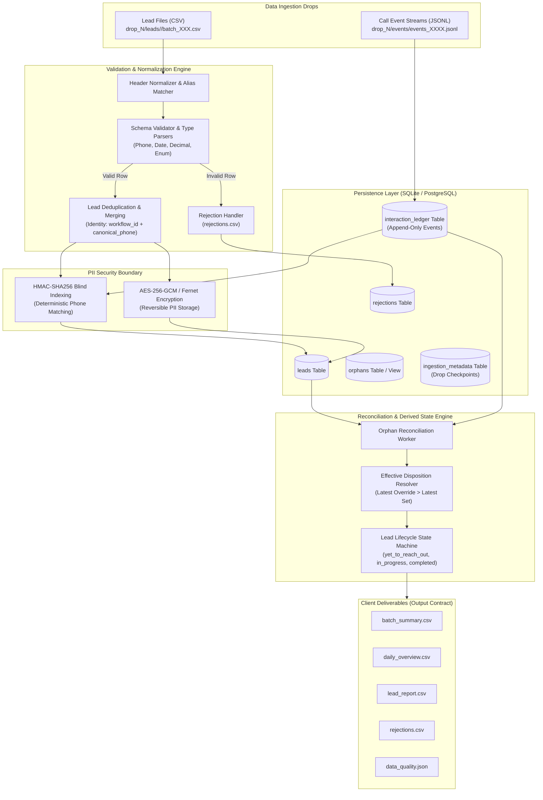

# Specification: 00 - Project Overview & System Architecture

## 1. Executive Summary & Purpose

Agentic Universe builds autonomous AI voice agents for enterprise clients (insurers, lenders, and consumer brands) across India and APAC. These agents manage mission-critical voice campaigns, including outbound policy renewal reminders (`motor_renewal`) and post-purchase customer feedback collection (`policy_feedback`).

Every business morning, enterprise clients rely on platform-generated reporting to answer core commercial and operational questions:
- How many leads were contacted?
- What was the call connectivity rate?
- How many customers renewed their policies or registered feedback?
- Which leads require agent callbacks or supervisor intervention?

The **Interaction Ledger & Reporting Pipeline** (`interaction-ledger`) is the foundational data infrastructure responsible for ingesting disparate, messy lead batches and asynchronous call event streams into an **append-only interaction ledger**. It validates, normalizes, deduplicates, and securely persists records in a relational database, guaranteeing complete auditability, PII protection at rest, strict idempotency, and exact arithmetic across all generated client reports.

```
+---------------------------------------------------------------------------------------------------+
|                                      AGENTIC UNIVERSE ARCHITECTURE                                |
|                                                                                                   |
|   +-----------------------+       +-----------------------------+       +---------------------+   |
|   |      DATA LAYER       | ----> |       WORKFLOW LAYER        | ----> |  APPLICATION LAYER  |   |
|   |  Interaction Ledger   |       |    Campaigns, Schedules,    |       |   Dashboards, APIs, |   |
|   |  & Reporting Pipeline |       |   Dispatches, Callbacks     |       |    Client Consoles  |   |
|   +-----------------------+       +-----------------------------+       +---------------------+   |
+---------------------------------------------------------------------------------------------------+
```

---

## 2. Core Business Problems Solved

1. **Messy & Uncontrolled Ingestion Inputs:**
   - Client lead uploads contain inconsistent header casings/aliases, extra columns, blank rows, varied date representations (ISO, UK, mixed text months), arbitrary currency symbols (`₹`, `Rs.`, `INR`), and invalid phone numbers.
   - Lead rows must be strictly validated against workflow schemas in exact schema order.
2. **Distributed & Out-of-Order Event Arrival:**
   - Call events arrive asynchronously in JSON Lines (`.jsonl`) streams.
   - Events may contain malformed syntax, duplicate `event_id` keys, missing fields, or unrecognized disposition codes.
   - **Late-Arriving Leads / Orphan Events:** Call events frequently arrive in an earlier drop before the client operations team uploads the corresponding lead batch in a subsequent drop. The pipeline must dynamically quarantine orphans and resolve them retroactively upon lead ingestion.
3. **Immutable Interaction Ledger & Auditability:**
   - Overrides (human supervisor corrections) must never alter or overwrite past event records. The ledger is strictly append-only.
4. **Data Privacy & PII Compliance:**
   - Personally Identifiable Information (customer names, phone numbers) must never reside in plaintext at rest, while still supporting deterministic lookup and matching between phone numbers in leads and events.
5. **Exact Arithmetic & Diff-Clean Reports:**
   - Every number produced across five report files (`batch_summary.csv`, `daily_overview.csv`, `lead_report.csv`, `rejections.csv`, and `data_quality.json`) must reconcile with 100% precision against raw events and lead states.

---

## 3. High-Level System Architecture



---

## 4. Key Functional Modules

### 4.1 Lead Ingestion & Normalization Module
- **Header Normalization:** Lowercase, strip, normalize whitespace and underscores into single spaces, and match against schema field names and aliases.
- **Row Handling:** Skip empty/whitespace-only rows without incrementing row counters. Count row numbers sequentially (1-based, excluding header).
- **Type Parsing:**
  - `phone`: Strip non-digits; handle `91` (12 digits) and `0` (11 digits) prefixes; validate 10 digits starting with `6`, `7`, `8`, or `9`; canonical format `+91XXXXXXXXXX`.
  - `date`: Day-first parsing supporting `YYYY-MM-DD`, `DD/MM/YYYY`, `DD-MM-YYYY`, and `DD-Mon-YYYY`. Reject impossible dates (e.g., 31/02).
  - `decimal`: Parse optional currency prefixes (`₹`, `Rs`, `Rs.`, `INR`), strip commas, ensure $\ge 0$, and round to 2 decimal places.
  - `enum`: Case-insensitive validation against allowed values; persist lowercase.
- **Rejection Precedence:** Schema-order evaluation. First failure causes immediate rejection:
  - `missing_required:<field_name>`
  - `invalid_phone`
- **Field Warnings:** Non-required field with invalid format becomes `NULL` and increments `field_warnings`.
- **Deduplication & Last-Write-Wins:**
  - Identity: `(workflow_id, canonical_phone)`.
  - First valid row sets permanent `batch_id`.
  - Subsequent duplicate rows overwrite only non-null fields (last-write-wins) and increment `duplicate_lead_rows_merged`.
  - Schema defaults apply post-merge to remaining `NULL` fields.

### 4.2 Append-Only Interaction Ledger Module
- **Sequential Line Processing Order:**
  1. *Malformed:* Invalid JSON or missing `event_id`.
  2. *Duplicate:* `event_id` already ingested (in current or prior drop) is skipped.
  3. *Orphan Check:* Event cannot be matched to an ingested lead via `(workflow_id, canonical_phone)` or override `call_id`.
  4. *Unknown Disposition:* Disposition code not in `dispositions.csv` for that workflow.
- **Timestamp Standardization:** Parse UTC (`Z`), explicit offsets (`+05:30`), and naive timestamps (assumed IST) into canonical IST timestamps (`Asia/Kolkata`).
- **Override Processing:** A `disposition.override` event lacks a `phone` field and links exclusively through its `call_id` to that call's existing lead.

### 4.3 PII Protection & Data Security Module
- Any field tagged `"pii": true` (e.g. `customer_name`, `phone`) is protected at rest:
  - **Deterministic Lookup (Blind Index):** Cryptographic HMAC-SHA256 hash using a server-side secret key enables join queries between leads and event streams without exposing raw phone numbers.
  - **Encrypted Storage:** Raw PII values are encrypted using AES-256-GCM / authenticated symmetric encryption.
  - **Masking for Reports:** Phone numbers in exports follow `+91******XXXX` masking format.

### 4.4 Reporting & Analytics Engine
Produces the five contractually required output files:
1. `batch_summary.csv`: Aggregated lead counts and lifecycle bucket distributions per `(workflow_id, batch_id)`.
2. `daily_overview.csv`: Daily call volumes, connected call counts, connectivity rates (formatted to 4 decimal places), and distinct success leads per `(workflow_id, ist_date)`.
3. `lead_report.csv`: Per-lead interaction status, masked phone, lifecycle bucket, total calls, connected calls, latest call timestamp, latest effective disposition, and historical success indicator.
4. `rejections.csv`: Audit log of all rejected rows with `workflow_id, batch_id, row_number, reason` (strictly free of PII).
5. `data_quality.json`: Summary telemetry metrics covering lead row totals, rejection breakdowns, merged duplicates, warnings, event stream totals, drops, and orphans.

---

## 5. Non-Functional Requirements & Engineering Standards

| Dimension | Standard |
|---|---|
| **Language & Runtime** | Python 3.11+ using strict type annotations (`typing`, `dataclasses`, `pydantic` or pure standard library / SQLAlchemy). |
| **Persistence Engine** | SQLite (default zero-dependency embeddable engine) / PostgreSQL. Schema strictly relational with unique constraints and foreign keys. |
| **Idempotency** | Processing drop 1 multiple times must result in identical state. Processing `drop_1` then `drop_2` must yield identical results to processing `drop_1 + drop_2` simultaneously. |
| **Immutability** | No destructive updates or deletions in the interaction ledger table. |
| **Execution Performance** | Capable of processing small datasets (<1s) and scaling seamlessly to large datasets (~140k leads, ~600k events in <2 minutes). |
| **Testability** | 100% test coverage on edge cases: phone normalization, date parsing, override resolution, lead bucket classification, and orphan re-linking. |

---

## 6. Project Directory Layout

```
interaction-ledger/
├── specs/
│   ├── 00-project-overview.md             # This document: Architecture & System Overview
│   ├── 01-schema-and-data-models.md       # Relational DB Schemas, Indexes, & PII Encryption
│   ├── 02-lead-ingestion-spec.md          # Lead Parsing, Normalization, Rejection, & Merging
│   ├── 03-event-ledger-spec.md            # Append-Only Ledger, Ingestion Pipeline, & Orphans
│   ├── 04-reporting-and-analytics-spec.md # Derived Metrics, Buckets, & Output Contracts
│   └── 05-verification-and-dod-spec.md    # Test Plan, Invariants, & Definition of Done
├── src/
│   ├── __init__.py
│   ├── cli.py                             # CLI commands: ingest, report, reset
│   ├── config.py                          # Application settings & cryptographic secrets
│   ├── db/                                # Database connection, migrations, & models
│   ├── ingestion/                         # Ingestion engines (leads, events, headers, types)
│   ├── ledger/                            # Append-only interaction ledger & orphan reconciler
│   ├── security/                          # HMAC blind indexing & PII encryption
│   └── reporting/                         # Report generators & contract exporters
├── tests/
│   ├── test_phone_normalization.py
│   ├── test_date_and_type_parsers.py
│   ├── test_lead_dedup_and_merge.py
│   ├── test_override_resolution.py
│   ├── test_lead_buckets.py
│   ├── test_orphan_reconciliation.py
│   └── test_end_to_end_pipeline.py
├── schemas/                               # Workflow lead schemas & disposition catalogues
├── requirements.txt
├── SUBMISSION.md
└── AI_USAGE.md
```

---

## 7. Next Specification Milestone

The next specification to document is **`specs/01-schema-and-data-models.md`**, which will define:
- Exact relational table structures (`leads`, `interaction_ledger`, `lead_rejections`, `orphans`, `ingestion_runs`).
- PII handling schema (blind index hash column vs. encrypted ciphertext payload).
- SQLite / PostgreSQL DDL statements with constraints and indexes.
- Ingestion checkpointing and transaction boundaries for idempotency.
