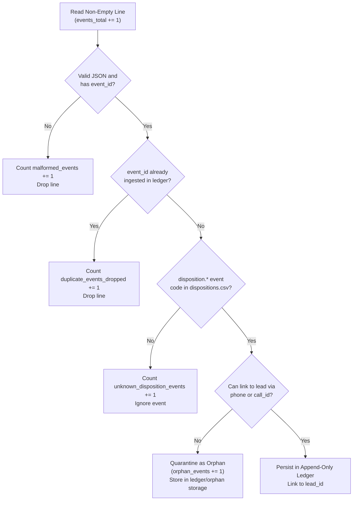
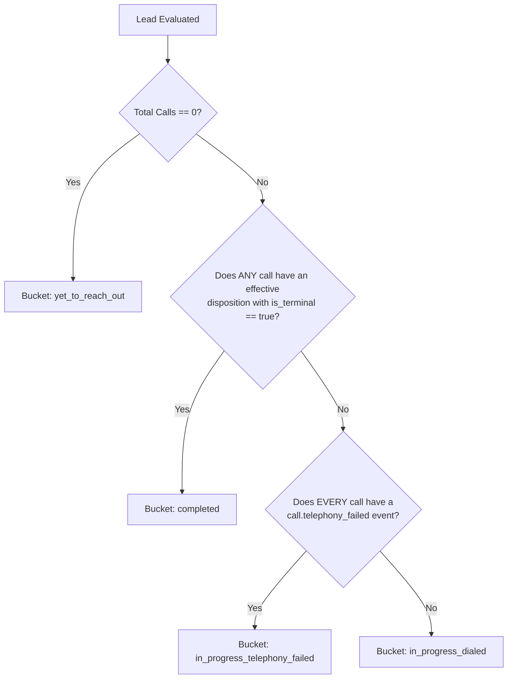

# Specification: 01 - Functional Requirements Document

- **Module Name:** Functional Requirements Specification (`interaction-ledger`)
- **Status:** APPROVED / IN REVIEW
- **Target Version:** 1.0.0
- **Parent Spec:** `specs/00-project-overview.md`
- **Reference Spec:** `assignment-a-data/README.md` & `docs/GLOSSARY.md`

---

## 1. Scope & Objectives

This document defines the complete functional requirements for the **Interaction Ledger & Reporting Pipeline**. It provides exact, testable, and unambiguous rules for:
1. Lead file parsing, schema-driven header resolution, field-level normalization, rejection precedence, and deduplication/merging.
2. Call event stream parsing, filtering, deduplication, timestamp normalization, and append-only ledger persistence.
3. Supervisor override resolution and orphan event late-binding.
4. Lead lifecycle state machine and metric derivation.
5. PII protection at rest and masked export generation.
6. The exact output contract for all 5 report deliverables and the CLI operational interface.

---

## 2. Lead Ingestion Requirements (FR-LEAD)

### FR-LEAD-01: File Discovery & Processing Order
- **Input Location:** Leads are discovered under `<drop_path>/leads/<workflow_id>/*.csv`.
- **Determinism:** Drops must be processed in the order received/invoked. Files within a drop must be processed in alphabetical/lexicographical order by filename (`batch_001.csv`, `batch_002.csv`). Rows within a file must be processed sequentially from row 1 to row $N$.

### FR-LEAD-02: Header Normalization & Alias Mapping
- For every CSV file, the header row must be resolved against the workflow's JSON schema (e.g., `motor_renewal.json`, `policy_feedback.json`).
- **Header Normalization Algorithm:**
  1. Convert header string to lowercase.
  2. Strip leading and trailing whitespace.
  3. Replace any run of underscores (`_`) or whitespace characters (`\s+`) with a single ASCII space (` `).
- **Matching Precedence:**
  - Match normalized header against normalized field `name`.
  - If no match, match against normalized `aliases` listed in the schema.
  - If still unmatched, the column is an unmapped extra column and **must be safely ignored**.
- If a schema field marked `"required": true` is missing from the header row entirely, every non-blank data row in that file fails validation for that field (see FR-LEAD-05).

### FR-LEAD-03: Row Filtering & Row Numbering
- **Blank Row Exclusion:** A row is blank if every cell in the row is either empty or contains only whitespace.
- Blank rows are skipped immediately:
  - They **must not** be counted in `lead_rows_total`.
  - They **must not** be assigned a row number.
  - They **must not** produce rejections or warnings.
- **Row Numbering:** Non-blank rows are numbered sequentially starting at **1** (the header row is excluded).

### FR-LEAD-04: Field-Level Value Normalization
All values are stripped of leading and trailing whitespace before type validation. An empty string (`""`) is treated as `NULL` / missing.

| Field Type | Parsing & Normalization Rules | Validation & Error Trigger | Canonical Stored Form |
|---|---|---|---|
| `string` | Trim leading/trailing whitespace. | None (valid if non-empty). | Pure trimmed UTF-8 string. |
| `phone` | 1. Strip all non-digit characters (`\D`).<br/>2. If 12 digits and starts with `91`, drop `91`.<br/>3. If 11 digits and starts with `0`, drop `0`. | Resulting digit string must be **exactly 10 digits** and start with **6, 7, 8, or 9**. Any other digit count or starting digit is invalid. | Canonical E.164-style: `+91XXXXXXXXXX`. |
| `date` | Parse day-first dates supporting:<br/>- `YYYY-MM-DD`<br/>- `DD/MM/YYYY`<br/>- `DD-MM-YYYY`<br/>- `DD-Mon-YYYY` (e.g. `01-Dec-2026`, case-insensitive month). | Impossible calendar dates (e.g., `31/02/2026`, `29/02/2025`) or unparseable strings are invalid. | Standard ISO Date string: `YYYY-MM-DD`. |
| `decimal` | 1. Strip currency prefixes: `₹`, `Rs`, `Rs.`, `INR` (case-insensitive, optional space after prefix).<br/>2. Strip thousands separators (`,`).<br/>3. Convert to decimal. | Value must be $\ge 0$. Negative numbers or non-numeric strings are invalid. | Decimal rounded to exactly 2 decimal places (`0.00`). |
| `enum` | 1. Trim and convert to lowercase.<br/>2. Match against schema `values` array (case-insensitively). | Values not present in `values` are invalid. | Stored as lowercase string. |

### FR-LEAD-05: Schema-Order Validation & Rejection Precedence
- Each non-blank row must be validated by traversing fields **strictly in the order they appear in the schema JSON**.
- The **first** validation failure encountered terminates validation for that row.
- **Rejection Reasons:**
  - If a required field is `NULL` or missing $\rightarrow$ reason is `missing_required:<field_name>`.
  - If the `phone` field is present but fails phone validation $\rightarrow$ reason is `invalid_phone`.
- **Handling of Rejected Rows:**
  - The row is rejected and **never persisted** as a valid lead.
  - It generates one entry in `rejections.csv` with `workflow_id, batch_id, row_number, reason`.
  - Increments `lead_rows_rejected` and the specific counter in `rejections_by_reason`.
  - **No PII** (customer name, raw phone, etc.) may be logged in rejections.

### FR-LEAD-06: Optional Field Failures (Field Warnings)
- If an **optional** field (`"required": false`) is present (non-empty) but fails type validation (e.g., invalid date format, invalid enum, negative decimal):
  - The field value is set to `NULL`.
  - The row is **NOT rejected**.
  - Increments `field_warnings` by 1.
- Field warnings are counted **only** for rows that pass validation and are not rejected.

### FR-LEAD-07: Lead Identity, Merging & Deduplication
- **Lead Identity:** A lead is uniquely identified by the composite tuple:
  $$\text{Identity} = (\text{workflow\_id}, \text{canonical\_phone})$$
- **Permanent Batch Attribution:**
  - The first valid row encountered for an identity creates the lead.
  - The file stem of that first row (e.g., `batch_001` for file `batch_001.csv`) permanently becomes the lead's `batch_id`.
  - Later uploads cannot overwrite `batch_id`.
- **Last-Write-Wins Merge:**
  - If a later valid row arrives with the same identity:
    - Increments `duplicate_lead_rows_merged` by 1.
    - Non-null fields in the new row overwrite existing lead fields.
    - If a field in the duplicate row is `NULL` (missing), the existing value is preserved.
- **Post-Merge Schema Defaults:**
  - After merging, if an optional field remains `NULL` and the schema defines a `"default"` value (e.g., `preferred_language -> "en"`), the default value is applied.

---

## 3. Event Ledger Requirements (FR-EVT)

### FR-EVT-01: Event Stream File Ingestion
- Events are discovered under `<drop_path>/events/*.jsonl`.
- Each non-empty line contains one JSON object representing a call event.
- Non-empty line count increments `events_total`.

### FR-EVT-02: Sequential Event Processing Pipeline
For every line read from an event stream, the pipeline must evaluate conditions in this exact sequence:



1. **Malformed Check:**
   - If line cannot be parsed as JSON, or does not contain a non-empty `event_id` string:
   - Increment `malformed_events` by 1 and discard.
2. **Duplicate Check:**
   - If `event_id` has already been ingested in the ledger (from the current or any previous drop):
   - Increment `duplicate_events_dropped` by 1 and discard.
3. **Unknown Disposition Check:**
   - If `event_type` is `disposition.set` or `disposition.override`:
   - Check if `payload.disposition_code` exists in `dispositions.csv` for the given `workflow_id`.
   - If not in the catalogue: increment `unknown_disposition_events` by 1 and ignore/drop.
4. **Orphan / Linkability Check:**
   - Standard events (`phone` present): Normalize `phone` using FR-LEAD-04 rules. Check if `(workflow_id, canonical_phone)` matches an existing lead.
   - Override events (`phone` absent): Match `call_id` to an existing call that already has a linked lead.
   - If no lead can be linked at this time: mark as an **orphan event**. Keep out of all operational reports.

### FR-EVT-03: Append-Only Invariant & Overrides
- The interaction ledger is strictly **append-only**.
- A `disposition.override` event has no `phone` field and contains `call_id`, `occurred_at`, and `payload: {disposition_code, overridden_by, reason}`.
- Overrides are stored as separate, immutable event records. The original `disposition.set` event is **never mutated or deleted**.

### FR-EVT-04: Timestamp & Timezone Normalization
- Event timestamps (`occurred_at`) arrive in three formats:
  1. ISO-8601 with UTC indicator: `2026-10-05T13:20:21Z`
  2. ISO-8601 with timezone offset: `2026-10-05T18:50:21+05:30`
  3. Naive timestamp: `2026-10-05 18:50:21`
- **Rule:** Naive timestamps are defined as **IST (`Asia/Kolkata`)**.
- All timestamps must be stored canonically or converted accurately to IST for daily report boundaries and ISO-8601 strings (`+05:30`).

### FR-EVT-05: Late-Arriving Leads & Dynamic Orphan Reconciliation
- Events may arrive in an earlier drop (e.g. `drop_1`) before their corresponding lead is uploaded in a subsequent drop (e.g. `drop_2`).
- When a new lead is ingested in `drop_2`:
  - The reconciliation worker checks quarantined orphan events for matching `(workflow_id, canonical_phone)`.
  - Matched events are promoted to linked ledger events.
  - Linked events immediately resolve calls and update `disposition.override` links for that `call_id`.
- Reports generated after `drop_2` reflect the newly linked events.
- In `data_quality.json`, `orphan_events` reflects the **final count of events that remain unresolved orphans** after all drops are processed.

---

## 4. Derived Facts & State Machine Requirements (FR-STATE)

### FR-STATE-01: Call Identification & Properties
- An interaction is counted as a **Call** if and only if its `call.initiated` event exists and is linked to a lead.
- If other events for a `call_id` exist without `call.initiated`, the interaction is **not** counted as a call.
- **Call Date:** The IST calendar date (`YYYY-MM-DD`) of the `call.initiated` event's `occurred_at` timestamp.
- **Connected Call:** A call is classified as connected if a `call.connected` event exists with the same `call_id`.

### FR-STATE-02: Effective Disposition Resolution
For any given call, its **effective disposition** is determined by:
1. Find all `disposition.override` events for that `call_id`. If one or more exist, select the code of the override with the latest `occurred_at`.
2. If no overrides exist, find all `disposition.set` events for that `call_id`. If one or more exist, select the code of the set event with the latest `occurred_at`.
3. If neither event exists, the call has **no effective disposition** (`NULL`).

### FR-STATE-03: Lead Lifecycle State Machine (Bucketing)
Every valid lead belongs to exactly one lifecycle bucket. Evaluate conditions in strict priority order (first match wins):



1. `yet_to_reach_out`: Lead has 0 initiated calls.
2. `completed`: Lead has at least 1 call whose effective disposition is marked `is_terminal=true` in `dispositions.csv`.
3. `in_progress_telephony_failed`: Lead has $\ge 1$ initiated calls, and **every** initiated call has an associated `call.telephony_failed` event.
4. `in_progress_dialed`: All remaining leads with $\ge 1$ calls that do not satisfy buckets 2 or 3.

---

## 5. Security & PII Protection Requirements (FR-SEC)

### FR-SEC-01: Zero Plaintext PII at Rest
- Any schema field marked `"pii": true` (specifically `customer_name` and `phone`) must **never** be stored as plaintext in database tables, log files, rejections, or cache records.

### FR-SEC-02: Blind Indexing for Exact Matching
- In order to match incoming call events to leads by phone without decrypting the entire database:
  - Generate a deterministic HMAC-SHA256 blind index from the canonical phone:
    $$\text{phone\_hash} = \text{HMAC-SHA256}(\text{key}=\text{SECRET\_KEY}, \text{msg}=\text{canonical\_phone})$$
  - Store `phone_hash` in an indexed column on the `leads` table and ledger records.
  - Queries join on `workflow_id` and `phone_hash`.

### FR-SEC-03: Reversible Authenticated Encryption
- To retrieve customer names or format masked phone numbers for reports, raw PII values are encrypted using AES-256-GCM (or Fernet authenticated encryption) before database insertion.
- The encryption key is provided via environment variable (`PII_SECRET_KEY`) or secure config.

### FR-SEC-04: Phone Masking in Exports
- In `lead_report.csv`, the phone number must be formatted as:
  `+91******` followed by the last 4 digits of the canonical phone (e.g. `+91******0036`).
- Under no circumstance should `rejections.csv` or error logs output customer names or unmasked phones.

---

## 6. Output Contract Requirements (FR-OUT)

All CSV files must use:
- A header row matching the exact column names specified.
- Comma (`,`) delimiter.
- Standard newlines (`\n` or `\r\n`).
- No index column.
- Booleans formatted as lowercase `true` or `false`.
- Empty strings for `NULL` / missing values.

### FR-OUT-01: `batch_summary.csv`
- **Path:** `<out_dir>/batch_summary.csv`
- **Sorting:** `ORDER BY workflow_id ASC, batch_id ASC`
- **Columns:**
  ```csv
  workflow_id,batch_id,total_leads,yet_to_reach_out,in_progress_telephony_failed,in_progress_dialed,completed
  ```
- **Invariant:** For every row:
  $$\text{total\_leads} = \text{yet\_to\_reach\_out} + \text{in\_progress\_telephony\_failed} + \text{in\_progress\_dialed} + \text{completed}$$

### FR-OUT-02: `daily_overview.csv`
- **Path:** `<out_dir>/daily_overview.csv`
- **Inclusion Filter:** Only workflows and IST dates that have **at least one call** (`call.initiated`).
- **Sorting:** `ORDER BY workflow_id ASC, date ASC`
- **Columns:**
  ```csv
  workflow_id,date,total_calls,connected_calls,connectivity_rate,success_leads
  ```
- **Metric Definitions:**
  - `date`: IST date string `YYYY-MM-DD`.
  - `total_calls`: Count of initiated calls on that date for that workflow.
  - `connected_calls`: Count of initiated calls on that date that have a `call.connected` event.
  - `connectivity_rate`: $\frac{\text{connected\_calls}}{\text{total\_calls}}$, formatted with **exactly 4 decimal places** (e.g. `0.5625`, `1.0000`, `0.0000`).
  - `success_leads`: Distinct count of leads with at least one call on that date whose effective disposition has `is_success=true`.

### FR-OUT-03: `lead_report.csv`
- **Path:** `<out_dir>/lead_report.csv`
- **Inclusion Filter:** Exactly one row per valid lead in the database.
- **Sorting:** `ORDER BY workflow_id ASC, external_ref ASC`
- **Columns:**
  ```csv
  workflow_id,external_ref,batch_id,phone_masked,bucket,total_calls,connected_calls,last_call_at,current_disposition,ever_success
  ```
- **Field Definitions:**
  - `external_ref`: Value of the schema field tagged `"reference": true` (e.g. `policy_number`).
  - `phone_masked`: `+91******XXXX` (FR-SEC-04).
  - `last_call_at`: Latest `call.initiated` occurred timestamp in IST ISO-8601 format (e.g., `2026-10-14T17:55:24+05:30`), or empty if 0 calls.
  - `current_disposition`: Effective disposition of the most recent call (by initiated timestamp) that has an effective disposition. Empty if none.
  - `ever_success`: `true` if any call for this lead has an effective disposition with `is_success=true`, else `false`.

### FR-OUT-04: `rejections.csv`
- **Path:** `<out_dir>/rejections.csv`
- **Sorting:** `ORDER BY workflow_id ASC, batch_id ASC, row_number ASC`
- **Columns:**
  ```csv
  workflow_id,batch_id,row_number,reason
  ```
- **Contents:** All rejected lead rows. Must contain zero customer PII.

### FR-OUT-05: `data_quality.json`
- **Path:** `<out_dir>/data_quality.json`
- **Schema:**
  ```json
  {
    "lead_rows_total": 0,
    "lead_rows_rejected": 0,
    "rejections_by_reason": {
      "invalid_phone": 0,
      "missing_required:customer_name": 0
    },
    "duplicate_lead_rows_merged": 0,
    "field_warnings": 0,
    "events_total": 0,
    "malformed_events": 0,
    "duplicate_events_dropped": 0,
    "orphan_events": 0,
    "unknown_disposition_events": 0
  }
  ```
- **Rules:**
  - `lead_rows_total`: Count of non-blank lead rows read across all ingested batches.
  - `lead_rows_rejected`: Total count of rejected lead rows.
  - `rejections_by_reason`: Dynamic dictionary mapping exact reason strings to count of occurrences.
  - `events_total`: Count of non-empty lines read from event files.
  - `orphan_events`: Final count of quarantined events that remain unlinked to any lead.

---

## 7. Operational & CLI Interface Requirements (FR-CLI)

### FR-CLI-01: Ingest Command
```bash
python -m src.cli ingest <drop_directory_path>
```
- Ingests all lead batches and event streams in `<drop_directory_path>`.
- Reconciles any previously orphaned events against newly ingested leads.
- Updates metadata checkpoints.
- Must be strictly idempotent: running `ingest` twice on the same drop produces no change in database state or metrics.

### FR-CLI-02: Report Command
```bash
python -m src.cli report --out <output_directory_path>
```
- Generates all 5 output contract files inside `<output_directory_path>`.
- Reads cumulative database state reflecting all drops ingested up to that point.

---

## 8. Requirements Traceability Matrix

| Requirement ID | Module / Component | Primary Verification Method |
|---|---|---|
| `FR-LEAD-01..03` | Lead Header & Row Parser | Unit test with messy CSV headers & empty rows |
| `FR-LEAD-04` | Type Normalization Engine | Property-based tests for phone, date, decimal, enum |
| `FR-LEAD-05..06` | Rejection & Warning Engine | Unit tests verifying schema order & warnings counter |
| `FR-LEAD-07` | Deduplication & Merge Engine | Integration tests with duplicate leads & null overrides |
| `FR-EVT-01..03` | Event Ingestion & Dedupe | Unit tests for malformed JSON, duplicate event IDs |
| `FR-EVT-04` | Timezone & IST Resolver | Timezone fixture tests (UTC, offsets, naive IST) |
| `FR-EVT-05` | Orphan Reconciliation Worker | Two-drop integration test (events in drop 1, lead in drop 2) |
| `FR-STATE-01..03` | Bucket & Disposition Resolver | Unit test against all priority branches and overrides |
| `FR-SEC-01..04` | PII Cryptographic Guard | Inspection of DB disk storage and exported CSV fields |
| `FR-OUT-01..05` | Contract Exporter | File diff against generated baseline reference drops |
| `FR-CLI-01..02` | CLI Runner | End-to-end CLI runs verifying re-ingest idempotency |
