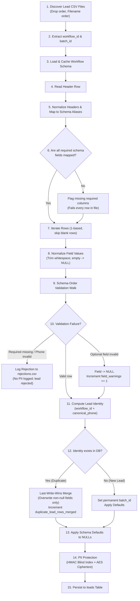

# Feature Specification: 02 - Lead Ingestion

- **Module Name:** Lead Ingestion Engine (`interaction-ledger.ingestion.leads`)
- **Status:** APPROVED / READY FOR DESIGN
- **Target Version:** 1.0.0
- **Parent Specs:** `specs/00-project-overview.md`, `specs/01-functional-requirements.md`

---

## 1. Objective

Build a schema-driven, idempotent CSV ingestion engine that reads customer lead files across multiple workflows, normalizes messy header and cell values, validates rows against strict workflow schemas, tracks rejections and warnings without leaking PII, performs stateful deduplication and merging, applies post-merge schema defaults, and securely persists valid leads in the relational database.

---

## 2. Input Specifications

### 2.1 File System Hierarchy
Lead files are discovered dynamically under the active drop directory:
```
<drop_directory>/leads/<workflow_id>/<batch_id>.csv
```
- **`<workflow_id>`**: Extracted directly from the parent directory name (e.g., `motor_renewal`, `policy_feedback`).
- **`<batch_id>`**: The file stem excluding `.csv` (e.g., `batch_001.csv` $\rightarrow$ `batch_001`).

### 2.2 Schema Definitions (`schemas/<workflow_id>.json`)
Each workflow has an associated JSON schema file containing:
- `workflow_id` (string): Unique identifier of the workflow.
- `fields` (array of objects): Ordered list of field definitions:
  - `name` (string): Canonical internal field identifier.
  - `type` (string): One of `string`, `phone`, `date`, `decimal`, `enum`.
  - `required` (boolean): Whether a valid value is mandatory for row acceptance.
  - `pii` (boolean, optional): If true, field must be encrypted at rest and never logged in plaintext.
  - `reference` (boolean, optional): If true, serves as the business `external_ref` for reporting.
  - `aliases` (array of strings, optional): Alternative column names found in messy CSV uploads.
  - `values` (array of strings, optional): Allowed lowercase values for `enum` fields.
  - `default` (string, optional): Default value applied post-merge if field is `NULL`.

---

## 3. Step-by-Step Processing Pipeline

The ingestion pipeline executes the following 15 distinct operations sequentially:



### Detailed Pipeline Stages:

1. **Discover CSV Files:**
   - Scan `<drop_path>/leads/<workflow_id>/*.csv`.
   - Process files in alphabetical/lexicographical order by filename within each workflow.
2. **Identify Workflow & Batch:**
   - Set `workflow_id = parent_directory_name`.
   - Set `batch_id = file_path.stem` (e.g. `batch_001`).
3. **Load Workflow Schema:**
   - Load and validate `schemas/<workflow_id>.json`.
   - Cache field definitions preserving their exact array order.
4. **Read CSV Header:**
   - Open CSV with UTF-8 encoding (handling UTF-8 BOM if present).
   - Read header tokens.
5. **Normalize Header Names:**
   - For each raw header token $H$:
     $$\text{norm}(H) = \text{replace\_all}(\text{strip}(\text{lower}(H)),\text{ pattern}=\text{"[\_\s]+"}, \text{ replacement}=" ")$$
6. **Map Headers to Schema Fields:**
   - For each normalized header, check equality against normalized schema field `name`.
   - If not matched, check equality against normalized strings in schema field `aliases`.
   - If matched, map `column_index -> field_definition`.
   - If unmatched, ignore the column.
7. **Read Non-Empty Rows & Numbering:**
   - For each line after header:
     - Check if all cell values are empty or whitespace. If so, **skip row entirely** (do not increment row counters, do not log warnings/rejections).
     - If non-empty, increment row counter $R$ (1-based, starts at 1 for the first non-blank data row).
     - Increment `lead_rows_total` telemetry counter by 1.
8. **Normalize Field Values:**
   - Trim leading and trailing whitespace from every cell string.
   - If trimmed string is empty (`""`), treat as `NULL` / missing.
9. **Schema-Order Validation:**
   - Traverse the fields **in the exact order defined in the schema JSON**.
10. **Reject Invalid Rows:**
    - If a field marked `"required": true` is `NULL` (or was unmapped from the header):
      - Rejection reason: `missing_required:<field_name>`. Stop evaluation.
    - If the `phone` field is present but fails canonical phone validation:
      - Rejection reason: `invalid_phone`. Stop evaluation.
    - Record entry in `rejections.csv` / `lead_rejections` table:
      - `(workflow_id, batch_id, row_number, reason)`
      - Increment `lead_rows_rejected` and `rejections_by_reason[reason]`.
      - Exclude row from further processing.
11. **Optional Field Failures (Warnings):**
    - If an optional field (`"required": false`) is present (non-null) but fails type parsing (e.g. malformed date, invalid enum option, invalid decimal):
      - Replace value with `NULL`.
      - Increment `field_warnings` telemetry counter by 1.
      - **Do not reject row.** Continue checking remaining fields.
12. **Calculate Lead Identity:**
    - For validated rows, compute canonical phone: `+91XXXXXXXXXX`.
    - Lead Identity is the unique tuple `(workflow_id, canonical_phone)`.
13. **Detect & Merge Duplicate Records:**
    - Check if a lead with `(workflow_id, canonical_phone)` already exists in the database or current ingestion session.
    - **If New Lead:**
      - Set permanent `batch_id` to current file's `batch_id`.
    - **If Existing Lead (Duplicate):**
      - Increment `duplicate_lead_rows_merged` telemetry counter by 1.
      - Retain original `batch_id` permanently.
      - Perform **Last-Write-Wins (Non-Null)** update: For each field in the incoming row, if the incoming value is non-null, overwrite the stored value. If the incoming value is `NULL`, retain the existing stored value.
14. **Apply Post-Merge Schema Defaults:**
    - Inspect all fields on the resulting lead record.
    - If any field is currently `NULL` and the schema defines a `"default"` key, assign the default value (e.g., `preferred_language = "en"`).
15. **Persist Valid Leads:**
    - Generate cryptographic HMAC-SHA256 blind index for phone lookup (`phone_bidx`).
    - Encrypt sensitive PII fields (`customer_name`, `phone`) using AES-256-GCM / Fernet.
    - Commit or stage record in the `leads` table.

---

## 4. Business Rules & Field Type Specifications

### 4.1 Phone Normalization (`phone`)
- **Objective:** Convert any valid Indian mobile number into canonical `+91XXXXXXXXXX`.
- **Parsing Steps:**
  1. Strip all non-digit characters (`\D`).
  2. If 12 digits and starts with `91`: remove the leading `91`.
  3. If 11 digits and starts with `0`: remove the leading `0`.
  4. Validate: The resulting string must be **exactly 10 digits**, and the first digit must be **6, 7, 8, or 9**.
  5. Canonical form: Prepend `+91` to the 10-digit number.
- **Truth Table / Examples:**

| Raw Input Value | Digits Stripped | Length & Prefix Check | Canonical Result | Outcome |
|---|---|---|---|---|
| `9876543210` | `9876543210` | 10 digits, starts with 9 | `+919876543210` | **VALID** |
| `+91 98765 43210` | `919876543210` $\rightarrow$ `9876543210` | 10 digits, starts with 9 | `+919876543210` | **VALID** |
| `09876543210` | `09876543210` $\rightarrow$ `9876543210` | 10 digits, starts with 9 | `+919876543210` | **VALID** |
| `91-77187-50036` | `917718750036` $\rightarrow$ `7718750036` | 10 digits, starts with 7 | `+917718750036` | **VALID** |
| `(+91) 8123456789` | `918123456789` $\rightarrow$ `8123456789` | 10 digits, starts with 8 | `+918123456789` | **VALID** |
| `6123456789` | `6123456789` | 10 digits, starts with 6 | `+916123456789` | **VALID** |
| `5123456789` | `5123456789` | 10 digits, starts with 5 | - | **INVALID** (Starts with 5) |
| `987654321` | `987654321` | 9 digits | - | **INVALID** (Too short) |
| `022-2430-1234` | `02224301234` | 11 digits, starts with 0 $\rightarrow$ `2224301234` (starts with 2) | - | **INVALID** (Landline) |
| `+1 415 555 0134` | `14155550134` | 11 digits, not 0-lead | - | **INVALID** (Non-Indian) |
| `N/A` or empty | - | 0 digits | - | **INVALID / REJECT** |

### 4.2 Date Normalization (`date`)
- **Supported Formats (Strictly Day-First):**
  1. `YYYY-MM-DD` (ISO)
  2. `DD/MM/YYYY` (Slash separator)
  3. `DD-MM-YYYY` (Dash separator)
  4. `DD-Mon-YYYY` (e.g. `01-Dec-2026`, `15-aug-2025` - case-insensitive month name)
- **Validation:**
  - Must represent a real calendar date (e.g., `31/02/2026` or `29-02-2025` are invalid).
- **Canonical Storage:** Stored as ISO `YYYY-MM-DD`.

### 4.3 Decimal Normalization (`decimal`)
- **Cleaning Steps:**
  1. Strip optional currency prefixes: `₹`, `Rs`, `Rs.`, `INR` (case-insensitive, optional whitespace).
  2. Remove comma thousands separators (`,`).
  3. Convert to decimal/float.
- **Validation:**
  - Must be a valid numeric value $\ge 0.00$.
- **Canonical Storage:** Rounded to exactly 2 decimal places (e.g. `12450.50`).

### 4.4 Enum Normalization (`enum`)
- **Cleaning Steps:**
  1. Strip whitespace.
  2. Convert to lowercase.
- **Validation:**
  - Must exist in the schema's `values` array.
- **Canonical Storage:** Lowercase token string.

### 4.5 Merging Logic (Last-Write-Wins for Non-Null)
For an existing lead $L$ and duplicate incoming row $D$:
$$\text{MergedField}_i = \begin{cases} D_i & \text{if } D_i \text{ is not NULL} \\ L_i & \text{otherwise} \end{cases}$$
- `batch_id` is immutable: $\text{MergedBatchID} = L_{\text{batch\_id}}$.

---

## 5. Error Handling & Edge Cases

| Condition / Edge Case | Pipeline Action | Telemetry Metric Effect | Output File Effect |
|---|---|---|---|
| Entire row is blank or whitespace | Discard row immediately. Do not assign row number. | None (not counted in totals). | Skipped. |
| Required field missing or `NULL` | Reject row on first missing required field in schema order. | `lead_rows_rejected += 1`<br/>`rejections_by_reason["missing_required:<field>"] += 1` | Entry in `rejections.csv`. |
| Phone missing | Reject row with `missing_required:phone`. | Same as missing required. | Entry in `rejections.csv`. |
| Phone present but invalid format | Reject row with `invalid_phone`. | `lead_rows_rejected += 1`<br/>`rejections_by_reason["invalid_phone"] += 1` | Entry in `rejections.csv`. |
| Optional field invalid format | Set field to `NULL`. Row continues as valid. | `field_warnings += 1` | Stored as `NULL` in DB. |
| Duplicate lead in same batch | Merge non-null fields over first record. Retain first `batch_id`. | `duplicate_lead_rows_merged += 1` | Updates lead record in DB. |
| Duplicate lead in later drop | Merge non-null fields over stored record. Retain original `batch_id`. | `duplicate_lead_rows_merged += 1` | Updates lead record in DB. |
| Unmapped extra columns in CSV | Silently ignore columns. | None. | Not stored. |
| Header casing / underscore differences | Normalize and match against schema names/aliases. | None. | Mapped properly. |

---

## 6. Acceptance Criteria

1. **Header Mapping:**
   - [x] Headers matching `customer_name`, `name`, `customer name`, `insured name`, `CUSTOMER_NAME` map to `customer_name`.
   - [x] Headers matching `mobile`, `mobile no`, `phone number`, `contact` map to `phone`.
   - [x] Unmapped headers (e.g. `notes`, `internal_id`) are safely ignored.
2. **Phone Normalization:**
   - [x] Correctly canonicalizes `9876543210`, `+91 98765 43210`, `09876543210`, `91-98765-43210`, and `(+91) 9876543210` to `+919876543210`.
   - [x] Rejects 9-digit phones, landlines (022...), international numbers (+1...), and prefixes starting with 0-5 with reason `invalid_phone`.
3. **Date & Decimal Normalization:**
   - [x] Day-first parsing correctly handles `05/11/2026`, `05-11-2026`, `05-Nov-2026`, and `2026-11-05`.
   - [x] Handles currency tokens `₹15,000`, `Rs. 15000.5`, `INR 1200` into `15000.00`, `15000.50`, `1200.00`.
   - [x] Malformed optional dates or negative amounts become `NULL` and increment `field_warnings`.
4. **Rejection Order:**
   - [x] If row is missing `customer_name` and has an invalid `phone`, rejection reason is `missing_required:customer_name` (schema order).
   - [x] Row numbers in `rejections.csv` exactly match non-blank rows (1-based).
5. **Deduplication & Defaults:**
   - [x] Original `batch_id` is permanently preserved when duplicate rows arrive in subsequent batches or drops.
   - [x] Non-null values overwrite previous values; `NULL` values do not overwrite existing data.
   - [x] Defaults (such as `preferred_language = "en"`) apply after merging to fields that remain `NULL`.
6. **PII Safety:**
   - [x] `rejections.csv` contains strictly `workflow_id,batch_id,row_number,reason` with zero PII.
   - [x] Leads in the database store PII encrypted with blind index hashing for exact matching.
