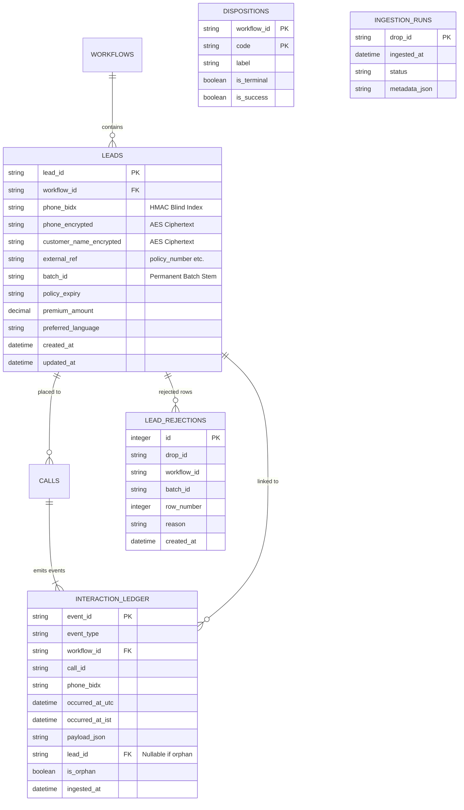
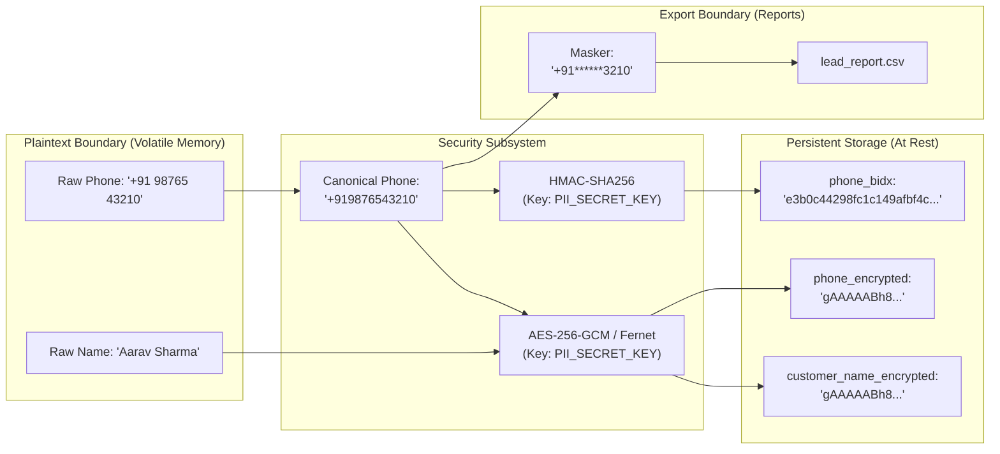

# Comprehensive Requirements & System Analysis: Interaction Ledger & Reporting Pipeline

- **Author:** Senior Backend Engineer
- **Project:** Agentic Universe Junior SDE Assignment A (`interaction-ledger`)
- **Status:** READY FOR REVIEW (Implementation Halted)
- **Document Version:** 1.0.0
- **Primary Source References:** `assignment-a-data/README.md`, `assignment-a-data/schemas/`, `assignment-a-data/tools/generate_data.py`, `docs/GLOSSARY.md`

---

## 1. Requirements Specification

### 1.1 Functional Requirements (FR)

#### Lead Ingestion & Schema Normalization (`FR-LD`)
- **`FR-LD-001` [Batch & Workflow Discovery]:** Discover lead CSV files dynamically under `<drop_path>/leads/<workflow_id>/*.csv`. Extract `workflow_id` from the directory name and `batch_id` from the file stem. Process drops in order received, files in filename order, and rows in file order.
- **`FR-LD-002` [Header Normalization & Alias Mapping]:** Normalize CSV headers by lowercasing, trimming, and replacing runs of underscores (`_`) and whitespace with a single space (` `). Match against schema field `name` or `aliases` (normalized identically). Ignore unmapped columns.
- **`FR-LD-003` [Blank Row Filtering]:** Detect rows where every cell is empty or contains only whitespace. Skip these rows immediately without counting in `lead_rows_total`, without assigning row numbers, and without generating warnings or rejections.
- **`FR-LD-004` [Sequential Row Numbering]:** Number non-blank data rows within each file sequentially starting at `1` (excluding header row).
- **`FR-LD-005` [Value Trimming & Nullability]:** Trim leading and trailing whitespace from every cell value. Treat empty strings (`""`) as `NULL` / missing.
- **`FR-LD-006` [Phone Normalization]:** Strip all non-digit characters. If 12 digits starting with `91`, drop `91`. If 11 digits starting with `0`, drop `0`. Validate that the result is exactly 10 digits starting with `6`, `7`, `8`, or `9`. Format and store canonically as `+91XXXXXXXXXX`.
- **`FR-LD-007` [Day-First Date Parsing]:** Parse dates using day-first semantics supporting `YYYY-MM-DD`, `DD/MM/YYYY`, `DD-MM-YYYY`, and `DD-Mon-YYYY` (e.g., `01-Dec-2026`, month case-insensitive). Reject impossible calendar dates (e.g., 31/02, 29/02/2025). Store canonically as `YYYY-MM-DD`.
- **`FR-LD-008` [Decimal Currency Parsing]:** Parse decimal values with optional currency prefixes (`₹`, `Rs`, `Rs.`, `INR`, case-insensitive, optional whitespace) and comma thousands separators. Validate value $\ge 0.00$. Round to 2 decimal places.
- **`FR-LD-009` [Enum Normalization]:** Case-insensitively match string against schema `values` array. Store canonically as lowercase.
- **`FR-LD-010` [Schema-Order Rejection]:** Traverse fields strictly in the order defined in the workflow schema. The first failure terminates row evaluation and records a single rejection reason:
  - Missing required field: `missing_required:<field_name>`
  - Present but invalid phone: `invalid_phone`
  Rejected rows are excluded from the `leads` table and recorded in `rejections.csv`.
- **`FR-LD-011` [Optional Field Warnings]:** If an optional field (`"required": false`) is present (non-empty) but fails type validation, store `NULL` and increment `field_warnings` by 1. Do not reject the row. Count warnings only for non-rejected rows.
- **`FR-LD-012` [Lead Identity & Permanent Batch ID]:** Define lead identity as the composite key `(workflow_id, canonical_phone)`. The first valid row encountered across drops sets the lead's permanent `batch_id`.
- **`FR-LD-013` [Last-Write-Wins Non-Null Merge]:** When a subsequent valid row matches an existing lead identity:
  - Increment `duplicate_lead_rows_merged` by 1.
  - Overwrite only fields where the incoming row has a non-null value.
  - Retain existing field values where the incoming row is `NULL`.
  - Retain the original `batch_id`.
- **`FR-LD-014` [Post-Merge Schema Defaults]:** After duplicate merging, if any field remains `NULL` and the schema specifies a `"default"` value (e.g., `preferred_language -> "en"`), assign that default value.

#### Append-Only Event Ledger (`FR-EV`)
- **`FR-EV-001` [Event Stream Discovery & Line Counting]:** Ingest JSONL files under `<drop_path>/events/*.jsonl`. Every non-empty line increments `events_total`.
- **`FR-EV-002` [Malformed Line Handling]:** If a line cannot be parsed as valid JSON or lacks a valid `event_id` string: increment `malformed_events` by 1 and discard line.
- **`FR-EV-003` [Event Deduplication]:** If `event_id` has already been ingested in any drop: increment `duplicate_events_dropped` by 1 and discard line.
- **`FR-EV-004` [Unknown Disposition Validation]:** If `event_type` is `disposition.set` or `disposition.override`, verify that `payload.disposition_code` exists in `dispositions.csv` for that `workflow_id`. If unknown: increment `unknown_disposition_events` by 1 and ignore/drop.
- **`FR-EV-005` [Orphan Detection & Quarantine]:** If an event cannot be linked to a valid lead:
  - Standard events: `phone` cannot be normalized or `(workflow_id, canonical_phone)` has no matching lead.
  - Override events: `call_id` has no known lead.
  Quarantine event in ledger storage as an orphan and exclude from operational reports. Increment `orphan_events`.
- **`FR-EV-006` [Supervisor Override Resolution]:** An event with `disposition.override` has no `phone` field. It must link via `call_id` to that call's lead. It never alters or deletes the original `disposition.set` event.
- **`FR-EV-007` [Timestamp Normalization to IST]:** Accept timestamps in UTC (`...Z`), timezone offset (`...+05:30`), or naive (`YYYY-MM-DD HH:MM:SS`). Naive timestamps must be interpreted as Indian Standard Time (IST, `UTC+05:30`). All reporting dates and timestamps must be rendered in IST.
- **`FR-EV-008` [Late-Arriving Lead Reconciliation]:** When new leads are ingested in subsequent drops, retroactively reconcile previously quarantined orphan events that match `(workflow_id, canonical_phone)`. Once linked, their calls and overrides must participate in reporting. `data_quality.json`'s `orphan_events` must reflect the final unresolved count.

#### Derived State & State Machine (`FR-ST`)
- **`FR-ST-001` [Call Qualification]:** A call is counted if and only if its `call.initiated` event is present and linked to a valid lead. Its date is the IST calendar date of `call.initiated.occurred_at`.
- **`FR-ST-002` [Call Connectivity]:** A call is classified as connected if a `call.connected` event exists with the same `call_id`.
- **`FR-ST-003` [Effective Disposition Calculation]:** For any call:
  1. Latest `disposition.override` by `occurred_at`.
  2. If none, latest `disposition.set` by `occurred_at`.
  3. If none, call has no effective disposition (`NULL`).
- **`FR-ST-004` [Lead Lifecycle Bucketing]:** Every valid lead must be placed in exactly one bucket based on strict precedence:
  1. `yet_to_reach_out`: 0 initiated calls.
  2. `completed`: Any call's effective disposition has `is_terminal=true`.
  3. `in_progress_telephony_failed`: Lead has $\ge 1$ calls, and **every** initiated call has a `call.telephony_failed` event.
  4. `in_progress_dialed`: All remaining leads with $\ge 1$ calls.

#### Reporting & CLI Interface (`FR-RP` & `FR-CL`)
- **`FR-RP-001` [Batch Summary Report]:** Generate `batch_summary.csv` grouped and sorted by `workflow_id ASC, batch_id ASC`.
- **`FR-RP-002` [Daily Overview Report]:** Generate `daily_overview.csv` for every workflow and IST date with $\ge 1$ call, sorted by `workflow_id ASC, date ASC`. Format `connectivity_rate` to exactly 4 decimal places. Count distinct leads with $\ge 1$ successful call on that date (`success_leads`).
- **`FR-RP-003` [Lead Report]:** Generate `lead_report.csv` for every valid lead, sorted by `workflow_id ASC, external_ref ASC`. Mask phone (`+91******XXXX`), compute `last_call_at` (IST ISO-8601), `current_disposition`, and `ever_success`.
- **`FR-RP-004` [Rejections Audit Report]:** Generate `rejections.csv` containing all rejected rows, sorted by `workflow_id ASC, batch_id ASC, row_number ASC`. Must contain zero PII.
- **`FR-RP-005` [Data Quality Telemetry]:** Generate `data_quality.json` matching the exact JSON key contract and counter totals.
- **`FR-CL-001` [CLI Ingestion Command]:** Support `<cli> ingest <drop_path>`. Must be strictly idempotent on re-runs.
- **`FR-CL-002` [CLI Report Command]:** Support `<cli> report --out <output_dir>`. Writes all 5 deliverables.

---

### 1.2 Non-Functional Requirements (NFR)

- **`NFR-SEC-001` [Zero Plaintext PII at Rest]:** Schema fields with `"pii": true` (`customer_name`, `phone`) must not be stored in plaintext in any persistent table, log, or rejection file.
- **`NFR-SEC-002` [Cryptographic Blind Indexing]:** Phone lookup must use a deterministic HMAC-SHA256 hash (`phone_bidx`) keyed by an environment secret (`PII_SECRET_KEY`) to support exact joins between leads and events without decrypting table data.
- **`NFR-SEC-003` [Authenticated Encryption at Rest]:** Raw PII values must be encrypted using AES-256-GCM (or Fernet authenticated envelope) prior to persistence.
- **`NFR-IDM-001` [Idempotent Ingestion]:** Ingesting the same drop path multiple times must not create duplicate records, alter counters, or produce divergent reports.
- **`NFR-IDM-002` [Incremental Equivalence]:** Ingesting `drop_1` followed by `drop_2` must yield identical state and report outputs to ingesting `drop_1` and `drop_2` in a single combined run.
- **`NFR-REL-001` [Strict Append-Only Invariant]:** The `interaction_ledger` table must never execute `UPDATE` or `DELETE` statements on event records.
- **`NFR-REL-002` [Relational Integrity & ACID]:** Persistence engine (SQLite / PostgreSQL) must enforce foreign keys, unique constraints on `event_id`, and atomic batch commits per file/drop.
- **`NFR-PRF-001` [Runtime Performance]:** Small scale drops (~1,000 leads) must process in $< 1.0\text{ s}$. Stretch goal: Large scale drops (~140,000 leads, ~600,000 events) must complete ingestion and reporting in $< 120\text{ s}$ on a standard laptop.

---

## 2. Business Rules Document (BR)

| Rule ID | Domain | Business Rule Statement | Verification / Enforcement Mechanism |
|---|---|---|---|
| **`BR-001`** | Headers | Header matching is case-insensitive, ignores runs of `_` and whitespace (collapsed to single space), and matches canonical `name` or `aliases`. Unmatched headers are ignored. | Normalized string comparison against JSON schema dictionary. |
| **`BR-002`** | Row Numbering | Blank rows (all cells empty or whitespace) are skipped and not counted. Row numbers are 1-based and increment only on non-blank data rows. Header row is not numbered. | Row scanner skips before counter increment. |
| **`BR-003`** | Phone Format | Indian mobile number only. Strip non-digits. Remove leading `91` (if 12 digits) or `0` (if 11 digits). Must be exactly 10 digits starting with `6, 7, 8, 9`. Stored as `+91XXXXXXXXXX`. | Strict regex / substring normalization engine. |
| **`BR-004`** | Date Format | Dates are strictly day-first. Formats: `YYYY-MM-DD`, `DD/MM/YYYY`, `DD-MM-YYYY`, `DD-Mon-YYYY` (case-insensitive month). Impossible dates are invalid. | Explicit format parser with calendar validation (`datetime`). |
| **`BR-005`** | Decimal Format | Non-negative numeric value. Optional prefixes `₹`, `Rs`, `Rs.`, `INR`. Strip commas. Round to 2 decimal places. | Prefix stripping + float/Decimal round to 2 places. |
| **`BR-006`** | Enum Format | Compared case-insensitively against schema `values`. Stored in lowercase. | Case-insensitive membership test in set. |
| **`BR-007`** | Rejection Order | Rejections are evaluated in strict schema order. First failure becomes the sole reason (`missing_required:<field>` or `invalid_phone`). Row is not saved as a lead. | Sequential loop over schema field definitions. |
| **`BR-008`** | Optional Warning | An invalid optional field is stored as `NULL` and increments `field_warnings`. The row is not rejected. Warnings are counted only for non-rejected rows. | Fallback to `None` if field is not required. |
| **`BR-009`** | Lead Identity | Uniquely identified by `(workflow_id, canonical_phone)`. | Composite primary/unique constraint or blind index hash. |
| **`BR-010`** | Permanent Batch | The first valid row for an identity permanently locks `batch_id` to that row's file stem (e.g. `batch_001`). Subsequent rows cannot alter it. | Immutable `batch_id` attribute on lead entity. |
| **`BR-011`** | Lead Merging | Subsequent valid rows with same identity increment `duplicate_lead_rows_merged` and overwrite only non-null fields (last-write-wins). Existing non-null fields are preserved if incoming is null. | Selective coalesce / update logic on conflict. |
| **`BR-012`** | Schema Defaults | Default values apply after merging to any fields that remain `NULL`. | Post-merge pass applying schema `default` values. |
| **`BR-013`** | Line Ingestion | Event lines processed sequentially: 1) Malformed check $\rightarrow$ 2) Duplicate `event_id` check $\rightarrow$ 3) Unknown disposition check $\rightarrow$ 4) Orphan check. | Pipeline validator pipeline in event loop. |
| **`BR-014`** | Event Immutability | Overrides (`disposition.override`) do not mutate or delete existing `disposition.set` events. The ledger is append-only. | Append-only insert with no update/delete queries on events. |
| **`BR-015`** | Timezone IST | UTC (`Z`), explicit offset (`+05:30`), or naive. Naive is strictly IST. All reporting dates and `last_call_at` are in IST. | Zoneinfo conversion to `Asia/Kolkata`. |
| **`BR-016`** | Orphan Reconciliation | Events arriving before their lead are quarantined. When the lead arrives in a later drop, events must link dynamically and reflect in all reports. | Post-ingestion orphan reconciliation worker. |
| **`BR-017`** | Call Invariant | An interaction is counted as a call if and only if `call.initiated` is present and linked. Date is the IST date of `call.initiated`. | SQL/Filter condition: `event_type = 'call.initiated'`. |
| **`BR-018`** | Connected Call | A call is connected if a `call.connected` event exists with the same `call_id`. | Join / existence check on `call_id` with `call.connected`. |
| **`BR-019`** | Effective Disp | Latest `disposition.override` by `occurred_at`. If none, latest `disposition.set` by `occurred_at`. If neither, `NULL`. | Window function / max occurred_at sort partitioned by `call_id`. |
| **`BR-020`** | Lead Buckets | Precedence: 1) `yet_to_reach_out` (0 calls) $\rightarrow$ 2) `completed` (any call terminal) $\rightarrow$ 3) `in_progress_telephony_failed` (all calls telephony_failed) $\rightarrow$ 4) `in_progress_dialed`. | Ordered `CASE WHEN` evaluation. |
| **`BR-021`** | Connectivity Rate | $\frac{\text{connected\_calls}}{\text{total\_calls}}$, formatted to exactly 4 decimal places (e.g. `0.5625`). | String formatting `"{:.4f}".format(rate)`. |
| **`BR-022`** | Success Leads | Distinct leads with at least one call on that IST date whose effective disposition has `is_success=true`. | `COUNT(DISTINCT lead_id)` grouped by date with success filter. |
| **`BR-023`** | Masked Phone | Phone formatted as `+91******` followed by the last 4 digits of the canonical phone. | Substring masking `"+91******" + canonical_phone[-4:]`. |
| **`BR-024`** | Rejection PII | Rejections must contain strictly `workflow_id,batch_id,row_number,reason`. No customer names or raw phones. | Strict CSV schema enforcement on `rejections.csv`. |

---

## 3. Edge Cases & Failure Scenarios Document (EC)

| Edge Case ID | Scenario / Condition | Expected Pipeline Behavior | Risk Mitigation |
|---|---|---|---|
| **`EC-001`** | Row has whitespace-only cells (e.g. `   , ,  \n`). | Skipped completely. Row number does not advance; `lead_rows_total` does not increment. | Check `all(len(cell.strip()) == 0 for cell in row)` before incrementing row index. |
| **`EC-002`** | Missing required header column in CSV file (e.g., no `customer_name` column). | Every non-blank row in the file fails validation on `missing_required:<column>`. File produces 0 leads. | Detect unmapped required schema fields during header mapping phase. |
| **`EC-003`** | Multiple validation failures in one row (e.g. missing name AND invalid phone). | Sole rejection reason is determined by **schema order** (e.g. `missing_required:customer_name` comes before `phone`). | Iterate strictly through schema fields list, break on first failure. |
| **`EC-004`** | Phone has 11 digits starting with `91` (e.g. `9187654321`). | Does not meet 12-digit rule for dropping `91`. Not a valid 10-digit number. Rejected as `invalid_phone`. | Explicit check: drop `91` only if `len(digits) == 12`. |
| **`EC-005`** | Landline numbers with STD codes (e.g. `022-2430-1234`). | Dropping `0` leaves `2224301234` (starts with 2). Rejected as `invalid_phone`. | Validate first digit $\in \{6, 7, 8, 9\}$. |
| **`EC-006`** | Leap year invalid dates (e.g., `29/02/2025` or `31/04/2026`). | Invalid calendar date. If field is required, reject row; if optional, set to `NULL` + field warning. | Strict `datetime.strptime` validation. |
| **`EC-007`** | Ambiguous date string (e.g., `05/06/2026`). | Must be parsed as **day-first**: 5th June 2026, never May 6th. | Order date format attempts with day-first formats prioritized (`%d/%m/%Y`). |
| **`EC-008`** | Negative decimal amount (e.g. `₹ -500.00`). | Fails $\ge 0$ check. If optional, becomes `NULL` + field warning; if required, rejects. | Validate numerical value $< 0$. |
| **`EC-009`** | Duplicate lead has `NULL` value in second batch. | The existing non-null value from the first batch is preserved (non-null last-write-wins). | Merge function: `new_val if new_val is not None else existing_val`. |
| **`EC-010`** | Event line has invalid JSON syntax or truncated payload. | Discard line. Count `malformed_events += 1`. Ledger remains clean. | Wrapped `json.loads` in try-except block. |
| **`EC-011`** | Event line has valid JSON but missing `event_id` key or `event_id == ""`. | Discard line. Count `malformed_events += 1`. | Check `if not event.get("event_id"): malformed_events += 1`. |
| **`EC-012`** | Duplicate `event_id` within the same file or across drops. | Discard duplicate line. Count `duplicate_events_dropped += 1`. | Maintain in-memory set and DB unique constraint on `event_id`. |
| **`EC-013`** | `disposition.override` arrives for a `call_id` whose calls have not arrived yet. | Stored as orphan. When `call.initiated` or matching call event arrives, link to lead. | Orphan reconciliation includes resolving call overrides by `call_id`. |
| **`EC-014`** | `call.connected` or `call.ended` exists for a `call_id`, but `call.initiated` is missing. | Interaction is **NOT** counted as a call in `total_calls` or lead bucketing. | Reporting queries require join or filter on `call.initiated`. |
| **`EC-015`** | Two `disposition.set` events for same call with identical `occurred_at`. | Deterministic tie-breaking (e.g. secondary sort by `event_id` or insert sequence). | Explicit `ORDER BY occurred_at DESC, event_id DESC` in query. |
| **`EC-016`** | Lead has 0 calls in ledger. | Bucket is `yet_to_reach_out`. `last_call_at` and `current_disposition` are empty string in CSV. | Left join from leads to calls; coalesce empty fields. |
| **`EC-017`** | Lead has 1 telephony-failed call and 1 connected call with no disposition. | Bucket is `in_progress_dialed` (not all calls telephony failed, and none terminal). | Bucket rule evaluation order: Bucket 3 requires ALL calls failed. |
| **`EC-018`** | Ingest command executed twice sequentially on `data/drop_1`. | Database state, row counts, telemetry numbers, and generated reports must be identical. | Checkpoint tracking, idempotent upserts, and deduping. |
| **`EC-019`** | Drop 2 ingested: previously orphaned event from Drop 1 matches new lead. | Event is linked. `data_quality.json` reduces `orphan_events` to reflect final state. | Orphan reconciliation updates orphan status dynamically. |
| **`EC-020`** | CSV file contains UTF-8 Byte Order Mark (`\ufeff`). | Header normalizer or file reader handles BOM cleanly without corrupting the first column name. | Open CSV with `encoding="utf-8-sig"`. |

---

## 4. Risk & Ambiguity Register

| Risk ID | Ambiguity / Risk Description | Impact | Proposed Engineering Resolution & Assumption |
|---|---|---|---|
| **`RSK-001`** | **Orphan Reconciliation State Representation:** Spec states ledger is append-only, but events can be orphans initially and later linked. Does updating an orphan foreign key violate append-only ledger? | High | **Resolution:** The raw event log (`event_id`, payload, occurred_at) is strictly immutable. Linkage can be represented via a mutable `lead_id` foreign key column or a separate `event_lead_links` junction table. Marking link status does not mutate event history. |
| **`RSK-002`** | **Dispositions File Scope:** Does `dispositions.csv` apply globally or per workflow? | Medium | **Resolution:** Spec table has `workflow_id,code,label,is_terminal,is_success`. Validate `(workflow_id, disposition_code)`. |
| **`RSK-003`** | **Override Event with Unknown Disposition:** If a supervisor override specifies a disposition code not in `dispositions.csv`, should it count as `unknown_disposition_events` or orphan? | Medium | **Resolution:** Pipeline order specifies checking unknown disposition before orphan link. Count as `unknown_disposition_events` and drop. |
| **`RSK-004`** | **Event Phone Normalization Failures:** What if an event JSON has a phone number that cannot be parsed (e.g. 9 digits)? | Medium | **Resolution:** The event cannot link to any valid lead. It counts as `orphan_events` (or invalid phone). Under step 3 (Orphan), inability to link to a valid lead treats it as an orphan. |
| **`RSK-005`** | **Tie-breaking on Event Timestamps:** What if multiple `call.initiated` or `disposition.override` events have identical `occurred_at`? | Low | **Resolution:** Use `(occurred_at DESC, event_id DESC)` as deterministic tie-breaker. |
| **`RSK-006`** | **Daily Overview IST Date Boundary:** If a call spans across midnight IST (initiated 23:59:50, connected 00:01:10), which date owns the call? | Low | **Resolution:** Spec explicitly states: "The call's date is the IST date of `call.initiated`". |
| **`RSK-007`** | **PII Key Management:** Where should the PII encryption key and blind index secret come from? | High | **Resolution:** Read from environment variable `PII_SECRET_KEY` (defaulting to a deterministic development fallback key if not set, ensuring automated CI test reproducibility). |
| **`RSK-008`** | **Floating-point rounding issues in connectivity rate:** Floating point division can result in binary representation artifacts. | Medium | **Resolution:** Use `Decimal` arithmetic or standard `round(connected / total, 4)` and format using `"{:.4f}"`. |
| **`RSK-009`** | **Scale Large Performance Bottleneck:** Processing ~140k leads and ~600k events in Python row-by-row could exceed 2 minutes. | High | **Resolution:** Use SQLite/Postgres bulk batch inserts (`executemany` with batches of 5,000) and optimized indexing on `(workflow_id, phone_hash)` and `(call_id)`. |

---

## 5. Database Entities & Relational Data Model



### Table Definitions & Constraints

1. **`leads` Table:**
   - `lead_id` (TEXT PRIMARY KEY): UUID or hash of `(workflow_id, phone_bidx)`.
   - `workflow_id` (TEXT NOT NULL)
   - `phone_bidx` (TEXT NOT NULL, INDEXED): HMAC-SHA256 of canonical phone.
   - `phone_encrypted` (TEXT NOT NULL): AES-256-GCM ciphertext + IV + tag.
   - `customer_name_encrypted` (TEXT): AES-256-GCM ciphertext.
   - `external_ref` (TEXT NOT NULL, INDEXED): Schema reference value (e.g. `policy_number`).
   - `batch_id` (TEXT NOT NULL): Immutable batch file stem.
   - `policy_expiry` (DATE): Normalized ISO date string.
   - `premium_amount` (NUMERIC(10,2)): Normalized decimal.
   - `preferred_language` (TEXT): Normalized enum string.
   - `UNIQUE(workflow_id, phone_bidx)`

2. **`interaction_ledger` Table:**
   - `event_id` (TEXT PRIMARY KEY): Unique event identifier.
   - `event_type` (TEXT NOT NULL): `call.initiated`, `disposition.set`, etc.
   - `workflow_id` (TEXT NOT NULL)
   - `call_id` (TEXT NOT NULL, INDEXED)
   - `phone_bidx` (TEXT, INDEXED): Nullable for overrides.
   - `occurred_at_ist` (TIMESTAMP NOT NULL, INDEXED)
   - `payload_json` (TEXT NOT NULL): Raw event payload.
   - `lead_id` (TEXT, INDEXED, FK $\rightarrow$ `leads.lead_id`): `NULL` if orphan.
   - `is_orphan` (BOOLEAN NOT NULL DEFAULT 0)
   - `ingested_at` (TIMESTAMP NOT NULL)

3. **`dispositions` Table:**
   - `workflow_id` (TEXT NOT NULL)
   - `code` (TEXT NOT NULL)
   - `label` (TEXT NOT NULL)
   - `is_terminal` (BOOLEAN NOT NULL)
   - `is_success` (BOOLEAN NOT NULL)
   - `PRIMARY KEY (workflow_id, code)`

4. **`lead_rejections` Table:**
   - `id` (INTEGER PRIMARY KEY AUTOINCREMENT)
   - `drop_id` (TEXT NOT NULL)
   - `workflow_id` (TEXT NOT NULL)
   - `batch_id` (TEXT NOT NULL)
   - `row_number` (INTEGER NOT NULL)
   - `reason` (TEXT NOT NULL)

5. **`ingestion_runs` Table:**
   - `drop_id` (TEXT PRIMARY KEY): e.g. `drop_1`, `drop_2`.
   - `ingested_at` (TIMESTAMP NOT NULL)
   - `telemetry_json` (TEXT NOT NULL)

---

## 6. Security & PII Implementation Blueprint



1. **Blind Index Generation:**
   ```python
   def compute_blind_index(canonical_phone: str, secret_key: bytes) -> str:
       return hmac.new(secret_key, canonical_phone.encode("utf-8"), hashlib.sha256).hexdigest()
   ```
2. **Deterministic Lookups:**
   - Inbound event with phone $\rightarrow$ canonicalize $\rightarrow$ compute `phone_bidx` $\rightarrow$ `SELECT lead_id FROM leads WHERE workflow_id = ? AND phone_bidx = ?`.
3. **Reversible Decryption (Only for Report Generation):**
   - Customer name / canonical phone decrypted strictly in-memory during `lead_report.csv` generation to extract masked format `+91******XXXX`.

---

## 7. Reports Output Contracts

### 7.1 `batch_summary.csv`
- **Headers:** `workflow_id,batch_id,total_leads,yet_to_reach_out,in_progress_telephony_failed,in_progress_dialed,completed`
- **Sort:** `workflow_id ASC, batch_id ASC`
- **Invariant:** `total_leads = yet_to_reach_out + in_progress_telephony_failed + in_progress_dialed + completed`

### 7.2 `daily_overview.csv`
- **Headers:** `workflow_id,date,total_calls,connected_calls,connectivity_rate,success_leads`
- **Filter:** Workflows and dates with $\ge 1$ initiated call.
- **Sort:** `workflow_id ASC, date ASC`
- **Formatting:** `connectivity_rate` formatted with `%.4f` (e.g. `0.5625`).

### 7.3 `lead_report.csv`
- **Headers:** `workflow_id,external_ref,batch_id,phone_masked,bucket,total_calls,connected_calls,last_call_at,current_disposition,ever_success`
- **Sort:** `workflow_id ASC, external_ref ASC`
- **Formatting:**
  - `phone_masked`: `+91******` + last 4 digits.
  - `last_call_at`: IST ISO-8601 (e.g. `2026-10-14T17:55:24+05:30`) or empty.
  - `ever_success`: `true` or `false`.

### 7.4 `rejections.csv`
- **Headers:** `workflow_id,batch_id,row_number,reason`
- **Sort:** `workflow_id ASC, batch_id ASC, row_number ASC`
- **Privacy:** 100% free of PII.

### 7.5 `data_quality.json`
```json
{
  "lead_rows_total": 0,
  "lead_rows_rejected": 0,
  "rejections_by_reason": {},
  "duplicate_lead_rows_merged": 0,
  "field_warnings": 0,
  "events_total": 0,
  "malformed_events": 0,
  "duplicate_events_dropped": 0,
  "orphan_events": 0,
  "unknown_disposition_events": 0
}
```

---

## 8. Requirement Traceability Matrix (RTM)

| Req ID | Business Rules | Edge Cases | DB Entities | Test Module / Verification | Report / Deliverable Target |
|---|---|---|---|---|---|
| `FR-LD-001..005` | `BR-001, BR-002` | `EC-001, EC-020` | `leads`, `rejections` | `tests/test_header_and_row_parsing.py` | `rejections.csv`, `data_quality.json` |
| `FR-LD-006` | `BR-003` | `EC-004, EC-005` | `leads` (`phone_bidx`) | `tests/test_phone_normalization.py` | `lead_report.csv`, `data_quality.json` |
| `FR-LD-007..009` | `BR-004..006` | `EC-006..008` | `leads` | `tests/test_type_parsers.py` | `data_quality.json` (`field_warnings`) |
| `FR-LD-010..011` | `BR-007, BR-008` | `EC-002, EC-003` | `lead_rejections` | `tests/test_rejections_and_warnings.py` | `rejections.csv`, `data_quality.json` |
| `FR-LD-012..014` | `BR-009..012` | `EC-009` | `leads` | `tests/test_dedup_and_merging.py` | `batch_summary.csv`, `data_quality.json` |
| `FR-EV-001..003` | `BR-013` | `EC-010..012` | `interaction_ledger` | `tests/test_event_ingestion.py` | `data_quality.json` |
| `FR-EV-004` | `BR-013` | `RSK-003` | `dispositions` | `tests/test_event_dispositions.py` | `data_quality.json` |
| `FR-EV-005, 008` | `BR-016` | `EC-013, EC-019` | `interaction_ledger` | `tests/test_orphan_reconciliation.py` | `data_quality.json`, All Reports |
| `FR-EV-006` | `BR-014` | `EC-013` | `interaction_ledger` | `tests/test_supervisor_overrides.py` | `lead_report.csv`, `daily_overview.csv` |
| `FR-EV-007` | `BR-015` | `RSK-006` | `interaction_ledger` | `tests/test_timezone_handling.py` | `daily_overview.csv`, `lead_report.csv` |
| `FR-ST-001..002` | `BR-017, BR-018` | `EC-014` | `interaction_ledger` | `tests/test_call_qualification.py` | `daily_overview.csv`, `lead_report.csv` |
| `FR-ST-003` | `BR-019` | `EC-015` | `interaction_ledger` | `tests/test_effective_disposition.py` | `lead_report.csv`, `daily_overview.csv` |
| `FR-ST-004` | `BR-020` | `EC-016, EC-017` | `leads`, `ledger` | `tests/test_lead_buckets.py` | `batch_summary.csv`, `lead_report.csv` |
| `NFR-SEC-001..003`| `BR-023, BR-024` | `EC-003` | `leads` | `tests/test_pii_security.py` | DB Storage, `lead_report.csv` |
| `NFR-IDM-001..002`| `BR-010..012` | `EC-018` | All Tables | `tests/test_idempotency_and_incremental.py`| All Reports |
| `FR-RP-001..005` | `BR-021..024` | All Edge Cases | All Views | `tests/test_report_contracts.py` | All 5 Report Deliverables |
| `FR-CL-001..002` | CLI Invariants | `EC-018` | Ingestion Runner | `tests/test_cli_e2e.py` | Ingest & Report Commands |
