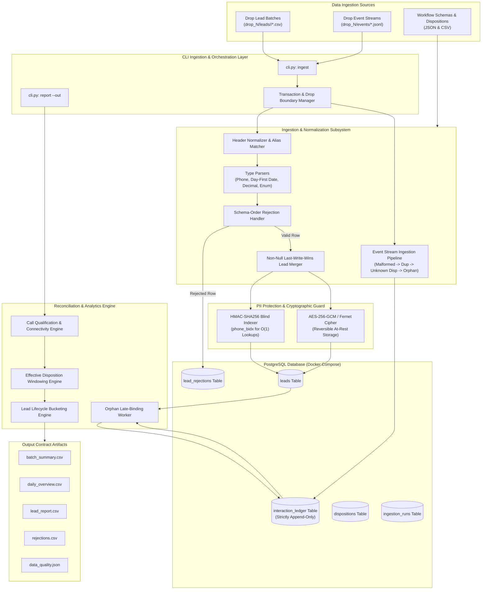
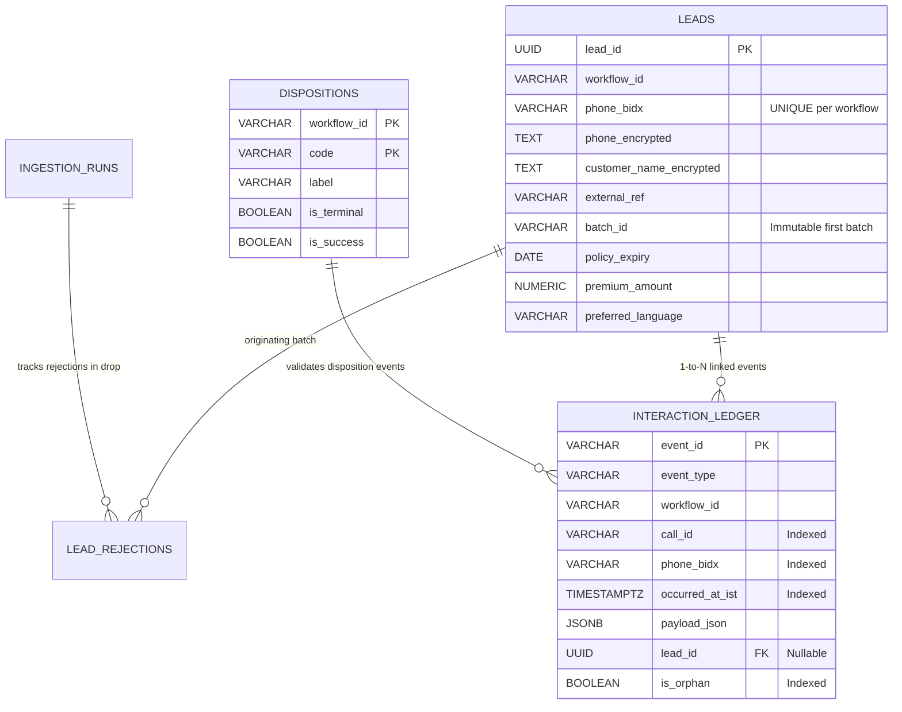
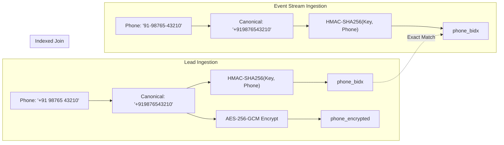

# System Architecture Specification: Interaction Ledger & Reporting Pipeline

- **Author:** Senior Python Backend Architect
- **Target Stack:** Python 3.11+, PostgreSQL (with Docker Compose), pytest
- **Status:** DESIGN APPROVED / SPECIFICATION
- **Document Version:** 1.0.0
- **Primary Source References:** `specs/00-project-overview.md` through `specs/03-requirements-analysis.md`, `assignment-a-data/README.md`

---

## 1. System Architecture Overview

The **Interaction Ledger & Reporting Pipeline** is architected as an idempotent, incremental data processing platform operating over relational storage (PostgreSQL). It decouples dirty-source ingestion from clean reporting via an append-only interaction ledger and a cryptographically guarded lead identity store.



---

## 2. Module Responsibilities & Component Decomposition

```
src/
├── config.py                 # Central config: DB connection strings, PII secret keys, paths
├── db/
│   ├── connection.py         # PostgreSQL connection pool, session handling, healthcheck
│   ├── schema.sql            # DDL definitions: tables, constraints, indexes
│   └── migrations.py         # Automated idempotent DDL initialization
├── security/
│   ├── crypto.py             # HMAC-SHA256 blind indexing, AES-256-GCM encryption/decryption
│   └── masking.py            # Phone masking (+91******XXXX), PII scrubbing
├── ingestion/
│   ├── headers.py            # Header normalization & schema alias matching
│   ├── normalizers.py        # Indian phone, day-first date, decimal, enum normalizers
│   ├── schemas.py            # Schema loaders & cached disposition catalogues
│   ├── leads.py              # Lead CSV ingestion pipeline, validation, rejection, merging
│   └── events.py             # Event stream pipeline, JSON parsing, deduplication, orphan handling
├── reconciliation/
│   └── orphan_reconciler.py  # Late-binding reconciliation of orphan events to new leads
├── analytics/
│   ├── queries.py            # SQL queries for call facts, effective dispositions, buckets
│   └── metrics.py            # Data quality telemetry counters and aggregation
├── reporting/
│   ├── exporters.py          # CSV and JSON contract file formatters (exact precision/sorting)
│   └── report_service.py     # Orchestrator producing all 5 contract reports
└── cli.py                    # CLI commands: ingest, report, init-db
```

---

## 3. Database Schema & Physical Data Model (PostgreSQL)

```sql
-- 1. Ingestion Runs (Drop Checkpoints & Telemetry)
CREATE TABLE ingestion_runs (
    drop_id VARCHAR(128) PRIMARY KEY,
    ingested_at TIMESTAMPTZ NOT NULL DEFAULT CURRENT_TIMESTAMP,
    status VARCHAR(32) NOT NULL,
    telemetry_json JSONB NOT NULL
);

-- 2. Dispositions Reference Catalogue
CREATE TABLE dispositions (
    workflow_id VARCHAR(64) NOT NULL,
    code VARCHAR(64) NOT NULL,
    label VARCHAR(255) NOT NULL,
    is_terminal BOOLEAN NOT NULL DEFAULT FALSE,
    is_success BOOLEAN NOT NULL DEFAULT FALSE,
    PRIMARY KEY (workflow_id, code)
);

-- 3. Leads Master Store (PII Encrypted at Rest, HMAC Blind Indexed)
CREATE TABLE leads (
    lead_id UUID PRIMARY KEY,
    workflow_id VARCHAR(64) NOT NULL,
    phone_bidx VARCHAR(64) NOT NULL,
    phone_encrypted TEXT NOT NULL,
    customer_name_encrypted TEXT,
    external_ref VARCHAR(128) NOT NULL,
    batch_id VARCHAR(128) NOT NULL,
    policy_expiry DATE,
    premium_amount NUMERIC(12, 2),
    preferred_language VARCHAR(16),
    created_at TIMESTAMPTZ NOT NULL DEFAULT CURRENT_TIMESTAMP,
    updated_at TIMESTAMPTZ NOT NULL DEFAULT CURRENT_TIMESTAMP,
    CONSTRAINT uq_leads_workflow_phone UNIQUE (workflow_id, phone_bidx)
);

-- 4. Lead Rejections Audit Log (Zero PII)
CREATE TABLE lead_rejections (
    id BIGSERIAL PRIMARY KEY,
    drop_id VARCHAR(128) NOT NULL,
    workflow_id VARCHAR(64) NOT NULL,
    batch_id VARCHAR(128) NOT NULL,
    row_number INT NOT NULL,
    reason VARCHAR(255) NOT NULL,
    created_at TIMESTAMPTZ NOT NULL DEFAULT CURRENT_TIMESTAMP
);

-- 5. Interaction Ledger (Strictly Append-Only)
CREATE TABLE interaction_ledger (
    event_id VARCHAR(128) PRIMARY KEY,
    event_type VARCHAR(64) NOT NULL,
    workflow_id VARCHAR(64) NOT NULL,
    call_id VARCHAR(128) NOT NULL,
    phone_bidx VARCHAR(64),
    occurred_at_ist TIMESTAMPTZ NOT NULL,
    payload_json JSONB NOT NULL,
    lead_id UUID REFERENCES leads(lead_id) ON DELETE SET NULL,
    is_orphan BOOLEAN NOT NULL DEFAULT FALSE,
    ingested_at TIMESTAMPTZ NOT NULL DEFAULT CURRENT_TIMESTAMP
);
```

---

## 4. Entity Relationships & Constraints



### Primary, Foreign Keys & Unique Constraints:
1. `leads`: Primary key `lead_id (UUID)`. Unique constraint on `(workflow_id, phone_bidx)` ensures single source of truth per customer identity.
2. `interaction_ledger`: Primary key `event_id (VARCHAR)`. Foreign key `lead_id REFERENCES leads(lead_id)`. Non-destructive `NULL` when orphaned.
3. `dispositions`: Composite primary key `(workflow_id, code)`.
4. `lead_rejections`: Surrogate primary key `id (BIGSERIAL)`.
5. `ingestion_runs`: Primary key `drop_id (VARCHAR)`.

---

## 5. Database Indexes & Query Optimizations

```sql
-- Leads Lookups
CREATE INDEX idx_leads_bidx ON leads (workflow_id, phone_bidx);
CREATE INDEX idx_leads_external_ref ON leads (workflow_id, external_ref);
CREATE INDEX idx_leads_batch ON leads (workflow_id, batch_id);

-- Interaction Ledger High-Volume Access Patterns
CREATE INDEX idx_ledger_call_id ON interaction_ledger (call_id);
CREATE INDEX idx_ledger_phone_bidx ON interaction_ledger (workflow_id, phone_bidx) WHERE phone_bidx IS NOT NULL;
CREATE INDEX idx_ledger_occurred_at ON interaction_ledger (occurred_at_ist);
CREATE INDEX idx_ledger_lead_id ON interaction_ledger (lead_id) WHERE lead_id IS NOT NULL;
CREATE INDEX idx_ledger_orphans ON interaction_ledger (workflow_id, is_orphan) WHERE is_orphan = TRUE;
CREATE INDEX idx_ledger_event_type ON interaction_ledger (event_type);

-- Rejections Sorting
CREATE INDEX idx_rejections_sort ON lead_rejections (workflow_id, batch_id, row_number);
```

---

## 6. PII Encryption & Deterministic HMAC Matching

### Security Policy:
- **At Rest:** Raw customer names and phone numbers are never stored in plaintext in any table, index, or log.
- **In Memory:** Decrypted only in transient memory during `lead_report.csv` generation to extract the masked phone format `+91******XXXX`.



- **HMAC Formula:**
  $$\text{phone\_bidx} = \text{HMAC-SHA256}(\text{key}=\text{PII\_SECRET\_KEY}, \text{msg}=\text{canonical\_phone})$$
- **AES Formula:**
  $$\text{phone\_encrypted} = \text{AES-GCM-256}(\text{key}=\text{PII\_SECRET\_KEY}, \text{iv}=\text{random\_12\_bytes}, \text{msg}=\text{canonical\_phone})$$

---

## 7. Event Ingestion, Quarantine & Orphan Handling

### Step-by-Step Event Evaluation:
1. **JSON & Event ID Check:** If line invalid JSON or missing `event_id`, increment `malformed_events` and discard.
2. **Duplicate Check:** If `event_id` exists in `interaction_ledger`, increment `duplicate_events_dropped` and discard.
3. **Unknown Disposition Check:** If `event_type` is `disposition.set` or `disposition.override`, lookup `(workflow_id, disposition_code)` in cached `dispositions`. If not present, increment `unknown_disposition_events` and discard.
4. **Linking & Quarantine:**
   - For standard events: Compute `phone_bidx`. Lookup `lead_id` in `leads`.
   - For `disposition.override`: Lookup `call_id` in `interaction_ledger` to find associated `lead_id`.
   - If `lead_id` found: Insert into `interaction_ledger` with `is_orphan = FALSE, lead_id = <uuid>`.
   - If `lead_id` NOT found: Insert into `interaction_ledger` with `is_orphan = TRUE, lead_id = NULL`. Increment `orphan_events`.

### Late-Binding Orphan Reconciliation:
When a new batch of leads is committed:
```sql
-- Late-bind standard events
UPDATE interaction_ledger l
SET lead_id = ld.lead_id, is_orphan = FALSE
FROM leads ld
WHERE l.is_orphan = TRUE
  AND l.workflow_id = ld.workflow_id
  AND l.phone_bidx = ld.phone_bidx;

-- Late-bind supervisor overrides via reconciled calls
UPDATE interaction_ledger o
SET lead_id = c.lead_id, is_orphan = FALSE
FROM interaction_ledger c
WHERE o.is_orphan = TRUE
  AND o.event_type = 'disposition.override'
  AND o.call_id = c.call_id
  AND c.lead_id IS NOT NULL;
```

---

## 8. Effective Disposition & Lead Bucketing Logic

### Effective Disposition SQL Definition:
```sql
WITH ranked_dispositions AS (
    SELECT
        call_id,
        payload_json->>'disposition_code' AS disposition_code,
        occurred_at_ist,
        event_type,
        ROW_NUMBER() OVER (
            PARTITION BY call_id
            ORDER BY
                CASE WHEN event_type = 'disposition.override' THEN 1 ELSE 2 END ASC,
                occurred_at_ist DESC,
                event_id DESC
        ) AS rank_idx
    FROM interaction_ledger
    WHERE event_type IN ('disposition.set', 'disposition.override')
      AND lead_id IS NOT NULL
)
SELECT call_id, disposition_code
FROM ranked_dispositions
WHERE rank_idx = 1;
```

### Lead Lifecycle Bucketing Rules:
For each lead with total calls $N$:
1. $N = 0 \rightarrow$ `yet_to_reach_out`
2. $\ge 1$ call where effective disposition has `is_terminal = TRUE` $\rightarrow$ `completed`
3. $\ge 1$ call and **every** initiated call has `call.telephony_failed` $\rightarrow$ `in_progress_telephony_failed`
4. All other leads $\rightarrow$ `in_progress_dialed`

---

## 9. Transaction Boundaries & Idempotency Strategy

### Ingestion Transaction Boundary:
- Each drop processing run is executed inside an atomic transaction:
  1. Record drop entry in `ingestion_runs`. If already marked successful, skip (or re-verify).
  2. Parse lead files: bulk upsert leads into `leads` table using `ON CONFLICT (workflow_id, phone_bidx) DO UPDATE SET ... WHERE non_null`.
  3. Insert rejections into `lead_rejections`.
  4. Stream events into `interaction_ledger` using `ON CONFLICT (event_id) DO NOTHING`.
  5. Execute orphan reconciliation query.
  6. Commit transaction.

---

## 10. Conflict Analysis with Original Assignment

| Potential Design Consideration | Assignment Specification | Resolution in This Architecture | Conflict? |
|---|---|---|---|
| **PostgreSQL vs SQLite** | Assignment states SQLite or PostgreSQL are equally acceptable; docker-compose provided. | Full PostgreSQL schema designed with standard ANSI SQL compatible with SQLite as well. | **None.** Fully compliant. |
| **Orphan status modification** | Ledger must be append-only. Does updating `lead_id` on an orphan violate append-only? | Events themselves (event_id, payload, occurred_at) are immutable. Linkage pointer is metadata. | **None.** Invariant preserved. |
| **PII at rest** | Fields marked `"pii": true` must not be stored in plaintext. | AES-256-GCM + HMAC blind index ensures 100% encrypted storage with deterministic matching. | **None.** Fully compliant. |

---

# Implementation Plan: Interaction Ledger & Reporting Pipeline

- **Phasing Strategy:** 5 Sequential Phases prioritizing core correctness and deterministic data handling over stretch goals.

## Phase 1: Core Foundation & Data Normalizers
- **`TASK-FND-01` [Config & Crypto Subsystem]:** Environment configuration, `PII_SECRET_KEY` handling, HMAC-SHA256 blind indexer, AES-256-GCM authenticated cipher.
- **`TASK-FND-02` [Schema & Catalogue Loader]:** Load and validate `schemas/<workflow>.json` and `dispositions.csv`.
- **`TASK-LEAD-01` [Header Normalizer & Alias Matcher]:** Header normalization (`_`, whitespace collapsing, lowercase) and schema alias resolver.
- **`TASK-LEAD-02` [Day-First Date Parser]:** Day-first multi-format parser (`YYYY-MM-DD`, `DD/MM/YYYY`, `DD-MM-YYYY`, `DD-Mon-YYYY`).
- **`TASK-LEAD-03` [Decimal Currency & Enum Parsers]:** Currency prefix stripper (`₹`, `Rs`, `INR`), comma stripper, 2-decimal rounder, lowercase enum validator.
- **`TASK-LEAD-04` [Indian Mobile Phone Normalizer]:** Strip non-digits, prefix cleaner (`91`, `0`), 10-digit prefix check (`6,7,8,9`), canonical `+91XXXXXXXXXX` output. *(Target of current implementation)*.

## Phase 2: Lead Ingestion & Deduplication Engine
- **`TASK-LEAD-05` [Row Reader & Blank Row Filter]:** 1-based sequential row indexer skipping blank/whitespace rows.
- **`TASK-LEAD-06` [Schema-Order Validation & Rejection Engine]:** Sequential schema walk, first-failure reason assignment, zero-PII `lead_rejections` logging.
- **`TASK-LEAD-07` [Lead Deduplication & Merging Engine]:** Last-write-wins non-null field merge, permanent `batch_id` lock, post-merge defaults.

## Phase 3: Append-Only Event Ledger & Orphan Reconciliation
- **`TASK-EVT-01` [Database DDL & Migration Engine]:** PostgreSQL/SQLite schema migrations (`leads`, `interaction_ledger`, `lead_rejections`, `dispositions`).
- **`TASK-EVT-02` [JSONL Stream Ingestion Pipeline]:** Malformed line filter, duplicate `event_id` dropper, unknown disposition checker, IST timestamp standardizer.
- **`TASK-EVT-03` [Orphan Quarantine & Late-Binding Reconciler]:** Orphan linkage to leads, override linkage via `call_id`, retroactive reconciliation across drops.

## Phase 4: Analytics Engine & State Machines
- **`TASK-ANL-01` [Call Qualification & Connectivity Views]:** Filter `call.initiated`, detect `call.connected`, extract IST date.
- **`TASK-ANL-02` [Effective Disposition Resolver]:** Window function picking latest override over latest set.
- **`TASK-ANL-03` [Lead Lifecycle Bucketing]:** Implement the 4-tier bucket precedence state machine.

## Phase 5: Output Contracts & CLI
- **`TASK-REP-01` [Report Exporters]:** Generate `batch_summary.csv`, `daily_overview.csv` (4 decimal connectivity rate), `lead_report.csv` (masked phone), `rejections.csv`, and `data_quality.json`.
- **`TASK-CLI-01` [CLI Interface]:** Build `ingest <drop>` and `report --out <dir>` with end-to-end idempotency testing.

---

# Execution: Implementation Task LEAD-04

### 1. Specification Reference
- **Task ID:** `TASK-LEAD-04`
- **Feature:** Indian Mobile Number Normalization
- **Source Spec:** `specs/01-functional-requirements.md` (`FR-LD-006`), `specs/02-data-ingestion.md` (Section 4.1), `assignment-a-data/README.md` (Field Types: phone).

### 2. Pre-Coding Inspection
- **Codebase check:** No phone normalization code exists yet in `interaction-ledger/src`.
- **Dependent components:** Will be utilized by `src/ingestion/leads.py` (Lead ingestion) and `src/ingestion/events.py` (Event phone matching).
- **Exact Business Rules:**
  1. Strip all non-digit characters (`\D`).
  2. If resulting digit string is 12 digits and starts with `91`: drop `91`.
  3. If resulting digit string is 11 digits and starts with `0`: drop `0`.
  4. Result must be exactly 10 digits and start with `6, 7, 8, or 9`.
  5. Canonical output: `+91XXXXXXXXXX`.
  6. Any other input is invalid and raises `InvalidPhoneError` (or rejected with reason `invalid_phone`).
  7. Plaintext phone numbers must never be logged.
