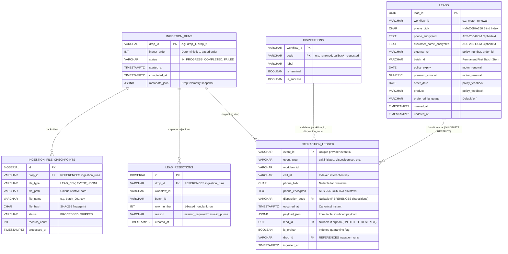

# Database Architecture and Schema Specification (DB-01 Final Revision)

- **Target Database Engine:** PostgreSQL 15+ (ANSI-standard SQL)
- **Status:** PRE-MIGRATION DESIGN GATE COMPLETED (Unexecuted DDL)
- **Parent Specifications:** `specs/00-project-overview.md` through `specs/04-system-architecture.md`
- **Source Requirements:** `assignment-a-data/README.md`, `schemas/`, `docs/GLOSSARY.md`

---

## 1. Design Review Findings and Resolutions

Following a compliance review of the database design against the original assignment README, both workflow schemas (`motor_renewal.json`, `policy_feedback.json`), and platform security rules, the following 6 core design decisions and revisions were established:

### Resolution 1: Append-Only Event Ledger & Immutability Trigger
- **Original Design:** `interaction_ledger` contained `lead_id` and `is_orphan` as mutable columns, with standard SQL `UPDATE` statements running during orphan reconciliation.
- **Identified Concern:** In an append-only ledger, table-level `UPDATE` permissions risk accidental mutation of event content (`event_id`, `event_type`, `occurred_at`, `payload_json`), violating auditability.
- **Evaluated Alternatives:**
  - *Alternative A: Separate Association Table (`event_lead_links`):* Zero `UPDATE` statements on `interaction_ledger`. An orphan has no row in `event_lead_links`. When reconciled, a row is inserted. However, this introduces an extra join for all 600k+ events during every reporting query.
  - *Alternative B: In-Table Association with PostgreSQL Immutability Trigger:* Retain `lead_id` and `is_orphan` on `interaction_ledger` for query performance, but enforce a PostgreSQL trigger (`trg_ledger_immutability`) that strictly forbids modifying `event_id`, `event_type`, `workflow_id`, `call_id`, `occurred_at`, `payload_json`, or `disposition_code`. The trigger permits only a single one-way transition:
    $$(lead\_id \text{ IS NULL}, is\_orphan = \text{TRUE}) \longrightarrow (lead\_id \text{ IS NOT NULL}, is\_orphan = \text{FALSE})$$
- **Selected Resolution:** **Alternative B (Controlled In-Table Association guarded by Database-Level Trigger)**. This eliminates query join overhead while enforcing cryptographic-level immutability on all event data.

### Resolution 2: PII Scrubbing in Event Payloads
- **Original Design:** Inbound event JSON was stored directly in `payload_json`.
- **Identified Concern:** Inbound call events include a top-level `"phone"` field (e.g. `"phone": "91-77187-50036"`). Storing raw event lines verbatim would store plaintext phone numbers on disk, violating Rule FR-SEC-01.
- **Selected Resolution:** During event ingestion, the phone is extracted, normalized, hashed into `phone_bidx`, and encrypted into `phone_encrypted`. The raw string is scrubbed from `payload_json`. The `payload_json` column stores only domain payload attributes (e.g. `{"reason": "carrier_rejected"}`, `duration_sec`, `overridden_by`).

### Resolution 3: Structured `disposition_code` with Composite Foreign Key
- **Original Design:** `disposition_code` was extracted dynamically from `payload_json->>'disposition_code'`.
- **Identified Concern:** JSON string extraction inside reporting views cannot enforce referential integrity at the database schema level.
- **Selected Resolution:** Add a dedicated, structured column `disposition_code VARCHAR(64)` on `interaction_ledger` (populated only for `disposition.set` and `disposition.override`). Enforce a composite foreign key:
  $$\text{FOREIGN KEY } (workflow\_id, disposition\_code) \text{ REFERENCES } dispositions(workflow\_id, code)$$
  This guarantees that unknown disposition codes are rejected or flagged at the database layer before participating in reports.

### Resolution 4: Exhaustive File Idempotency Matrix
- **Original Design:** Single checkpoint table relying on unique file path constraint.
- **Identified Concern:** Did not explicitly define behavior for identical content under different filenames, mutated files under same filenames, or retries after mid-transaction crashes.
- **Selected Resolution:** Implemented a two-tier checkpoint system (`ingestion_runs` + `ingestion_file_checkpoints`) using SHA-256 content hashes, strict drop order sequences, and transactional rollbacks.

### Resolution 5: Clarification on Blind Indexing vs. Encryption
- **Clarification:** A blind index is **not** encryption. HMAC-SHA256 is an irreversible, deterministic pseudonymized token used exclusively for equality matching (`O(1)` joins). Authenticated symmetric encryption (AES-256-GCM / Fernet) is the sole reversible encryption mechanism for PII storage at rest.

### Resolution 6: Referential Integrity on Lead Deletion
- **Selected Resolution:** Enforce `ON DELETE RESTRICT` on all foreign keys linking `interaction_ledger` to `leads`. Master leads cannot be deleted if historical interaction events exist.

---

## 2. Comprehensive Workflow Schema Coverage

The following matrix maps every field across both workflow schemas to its exact PostgreSQL storage representation, proving that **no required or optional schema field is omitted**:

| Workflow | Schema Field | Type | Required? | PII? | Default | PostgreSQL Column | PostgreSQL Type | Storage & Normalization Rule |
|---|---|---|---|---|---|---|---|---|
| `motor_renewal` | `customer_name` | `string` | **Yes** | **Yes** | None | `customer_name_encrypted` | `TEXT NOT NULL` | Trimmed, encrypted with AES-256-GCM. |
| `motor_renewal` | `phone` | `phone` | **Yes** | **Yes** | None | `phone_bidx`<br/>`phone_encrypted` | `CHAR(64) NOT NULL`<br/>`TEXT NOT NULL` | Canonical `+91XXXXXXXXXX`. Blind-indexed via HMAC-SHA256; encrypted via AES-256-GCM. Two separate columns. |
| `motor_renewal` | `policy_number` | `string` | **Yes** | No | None | `external_ref` | `VARCHAR(128) NOT NULL` | Marked `"reference": true`. Trimmed string. |
| `motor_renewal` | `policy_expiry` | `date` | No | No | None | `policy_expiry` | `DATE` | Day-first parsed ISO date (`YYYY-MM-DD`). `NULL` if invalid/missing. |
| `motor_renewal` | `premium_amount` | `decimal` | No | No | None | `premium_amount` | `NUMERIC(12, 2)` | Currency prefixes and commas stripped; rounded to 2 places. $\ge 0.00$. |
| `motor_renewal` | `preferred_language`| `enum` | No | No | `"en"` | `preferred_language` | `VARCHAR(16) NOT NULL` | Lowercase enum (`en, hi, ta, kn, te, mr`). Schema default applied post-merge. |
| `policy_feedback`| `customer_name` | `string` | **Yes** | **Yes** | None | `customer_name_encrypted` | `TEXT NOT NULL` | Trimmed, encrypted with AES-256-GCM. |
| `policy_feedback`| `phone` | `phone` | **Yes** | **Yes** | None | `phone_bidx`<br/>`phone_encrypted` | `CHAR(64) NOT NULL`<br/>`TEXT NOT NULL` | Canonical `+91XXXXXXXXXX`. Blind-indexed via HMAC-SHA256; encrypted via AES-256-GCM. Two separate columns. |
| `policy_feedback`| `order_id` | `string` | **Yes** | No | None | `external_ref` | `VARCHAR(128) NOT NULL` | Marked `"reference": true`. Trimmed string. |
| `policy_feedback`| `product` | `string` | No | No | None | `product` | `VARCHAR(128)` | Trimmed string. `NULL` if missing. |
| `policy_feedback`| `order_date` | `date` | No | No | None | `order_date` | `DATE` | Day-first parsed ISO date (`YYYY-MM-DD`). `NULL` if invalid/missing. |
| `policy_feedback`| `preferred_language`| `enum` | No | No | `"en"` | `preferred_language` | `VARCHAR(16) NOT NULL` | Lowercase enum (`en, hi, ta, kn, te, mr`). Schema default applied post-merge. |
| *Common System* | N/A | Surrogate | N/A | No | `gen_random_uuid()`| `lead_id` | `UUID PRIMARY KEY` | Internal surrogate primary key. |
| *Common System* | N/A | Batch Stem | N/A | No | None | `batch_id` | `VARCHAR(128) NOT NULL` | Permanent file stem of first valid occurrence (e.g. `batch_001`). Immutable. |

---

## 3. Defaults and Upsert Semantics

### 3.1 Complete Lifecycle for Optional Fields
The handling of optional fields (`preferred_language`, `policy_expiry`, `premium_amount`, `order_date`, `product`) is governed by a strict five-stage lifecycle spanning row extraction, in-memory deduplication, and database persistence:

1. **Incoming Missing Values Remain NULL During Deduplication:**
   When lead rows are parsed and validated from CSV files within a drop, blank or omitted fields are represented strictly as `None` (`NULL`). During within-drop deduplication across rows, missing fields remain `None`. They are **never** prematurely converted to schema defaults during row aggregation.
2. **Existing Non-Null Values are Preserved When Incoming Values are NULL:**
   When an incoming row has `NULL` for an optional field, and the lead record already possesses a non-null value (either from an earlier row in the same batch or from an existing lead record already persisted in the database), the existing non-null value is strictly preserved.
3. **Explicit Incoming Values Overwrite Existing Values (Last-Write-Wins):**
   When an incoming row provides an explicit, valid non-null value (e.g., `preferred_language = 'hi'`), it overwrites any previous value according to last-write-wins semantics, regardless of whether that previous value was an earlier user entry (e.g. `'ta'`) or a previously generated default (e.g. `'en'`).
4. **Schema Defaults are Applied Only When Final Value Remains Missing:**
   If, after deduplication of all available rows for that lead, an optional field has never received an explicit value and remains missing (`NULL`), and the workflow schema defines a `"default"` (such as `preferred_language = "en"`), the schema default is applied. This ensures newly created leads receive their intended defaults without leaving non-null constrained columns empty.
5. **Distinguishing Generated Defaults from User-Supplied Values Across Drops:**
   A central hazard in multi-drop ingestion pipelines is "default poisoning": if a drop prematurely applies a default (`"en"`) to an incoming record whose language was omitted, an upsert could mistakenly treat that generated default as an explicit user intent, overwriting an existing lead's custom preference (`"ta"`).
   
   The pipeline prevents this by decoupling **explicit user inputs** from **generated defaults** at both the application and SQL layers:
   - **Application-Bound Parameter Semantics (Not Native PostgreSQL Syntax):**
     The notation `:explicit_<field>` (e.g. `:explicit_preferred_language`) represents an **application-bound host parameter** supplied by the database driver (such as named dictionary parameters in Python `psycopg` / `sqlite3`, or positional `$N` / `%s` parameters), **not native PostgreSQL DDL/DML syntax or physical table columns**.
   - **Field-Presence & Merged Record State:**
     The application inspects the deduplicated `LeadRecord.values`. If the optional field was absent or blank across all rows in the incoming drop for that lead, the bound parameter is passed as literal Python `None` (SQL `NULL`). If the user provided an explicit non-null value in any row for that lead, the bound parameter is passed with the normalized value (e.g. `'hi'`), strictly preserving last-write-wins semantics.
   - **SQL-Level Upsert Semantics:**
     When executing `INSERT ... ON CONFLICT (workflow_id, phone_bidx) DO UPDATE`:
     - In the `VALUES(...)` clause (for `INSERT` of new leads):
       ```sql
       COALESCE(:explicit_preferred_language, 'en')
       ```
       If the lead is new and no language was supplied, `:explicit_preferred_language` is `NULL`, so the column receives the schema default `'en'`.
     - In the `ON CONFLICT DO UPDATE` clause (for updates to existing leads):
       ```sql
       preferred_language = COALESCE(:explicit_preferred_language, leads.preferred_language)
       ```
       If an existing lead already has `'ta'`, and Drop 2 provides no language, `:explicit_preferred_language` is `NULL`. The update evaluates `COALESCE(NULL, leads.preferred_language)`, which strictly retains `'ta'`.
       If Drop 2 provides `'hi'`, `:explicit_preferred_language` is `'hi'`, updating the column to `'hi'`.

### 3.2 Concrete Walkthrough Examples

#### Example 1: Brand New Lead with Missing Optional Field
- **Drop 1 Input:** Row arrives with `phone = "+919876543210"`, `preferred_language = ""` (omitted).
- **In-Memory Merging:** Field remains `None`. No prior records exist for this phone.
- **Application/SQL Sequence:**
  - Lead is identified as new.
  - SQL executes `INSERT ... VALUES (..., COALESCE(NULL, 'en'))`.
- **Database State:** Lead inserted with `preferred_language = 'en'`. (Schema default applied per Rule 4).

#### Example 2: Brand New Lead with Explicit Optional Field
- **Drop 1 Input:** Row arrives with `phone = "+919123456789"`, `preferred_language = "ta"`.
- **In-Memory Merging:** Field is normalized to `"ta"`.
- **Application/SQL Sequence:**
  - SQL executes `INSERT ... VALUES (..., COALESCE('ta', 'en'))`.
- **Database State:** Lead inserted with `preferred_language = 'ta'`. (User value stored per Rule 3).

#### Example 3: Existing Lead with User Value — Subsequent Drop Omits Field
- **Pre-Condition:** Lead exists in DB with `preferred_language = 'ta'`.
- **Drop 2 Input:** Duplicate row arrives with `phone = "+919123456789"`, `preferred_language = ""` (omitted).
- **In-Memory Merging:** Drop 2 row has `preferred_language = None`.
- **Application/SQL Sequence:**
  - In SQL upsert, `:explicit_preferred_language` is passed as `NULL`.
  - Conflict branch executes:
    `preferred_language = COALESCE(NULL, leads.preferred_language)`
- **Database State:** Evaluates to `leads.preferred_language` (`'ta'`).
- **Result:** Existing user value `'ta'` is **strictly preserved**. It is **never** overwritten by the schema default `'en'`.

#### Example 4: Existing Lead with User Value — Subsequent Drop Provides New Explicit Value
- **Pre-Condition:** Lead exists in DB with `preferred_language = 'ta'`.
- **Drop 2 Input:** Duplicate row arrives with `phone = "+919123456789"`, `preferred_language = "hi"`.
- **In-Memory Merging:** Drop 2 row has `preferred_language = "hi"`.
- **Application/SQL Sequence:**
  - In SQL upsert, `:explicit_preferred_language` is passed as `'hi'`.
  - Conflict branch executes:
    `preferred_language = COALESCE('hi', leads.preferred_language)`
- **Database State:** Evaluates to `'hi'`.
- **Result:** Last-write-wins successfully updates the preference from `'ta'` to `'hi'`.

#### Example 5: Existing Lead with Default Value — Subsequent Drop Omits Field
- **Pre-Condition:** Lead exists in DB with `preferred_language = 'en'` (from initial default).
- **Drop 2 Input:** Duplicate row arrives with `phone = "+919876543210"`, `preferred_language = ""` (omitted).
- **In-Memory Merging:** Drop 2 row has `preferred_language = None`.
- **Application/SQL Sequence:**
  - In SQL upsert, `:explicit_preferred_language` is passed as `NULL`.
  - Conflict branch executes:
    `preferred_language = COALESCE(NULL, leads.preferred_language)`
- **Database State:** Evaluates to `leads.preferred_language` (`'en'`).
- **Result:** Value remains `'en'` without redundant mutations.

### 3.3 Agreement Between Application and SQL Sequences
| Lifecycle Phase | Application State (`Python`) | Database State (`PostgreSQL`) |
|---|---|---|
| **CSV Row Extraction** | Blank strings converted to `None`. | N/A |
| **Within-Drop Deduplication** | `merge_lead_values()` preserves existing non-null values; incoming `None` does not overwrite. | N/A |
| **Drop Finalization (New Lead)** | `apply_schema_defaults()` fills missing fields with schema defaults (`"en"`). | `INSERT ... VALUES` writes explicit value or default (`'en'`). |
| **Drop Finalization (Existing Lead)** | Missing fields passed as `None` to persistence layer. | `ON CONFLICT DO UPDATE` uses `COALESCE(:explicit, leads.col)` to preserve DB value. |
| **Cross-Drop Upsert** | Re-entrant across any number of subsequent drops. | Idempotent and deterministic; zero default overwrites. |

---

## 4. Canonical Timestamp Storage (`TIMESTAMPTZ`)

### Evaluation: Replacing Redundant Columns with Single `occurred_at`
The previous design stored two timestamp columns: `occurred_at_utc` and `occurred_at_ist`. 

**Architectural Decision:** Replace both with a single canonical column:
```sql
occurred_at TIMESTAMPTZ NOT NULL
```
- **PostgreSQL Internal Storage:** PostgreSQL internally stores all `TIMESTAMPTZ` values in UTC as an 8-byte microsecond integer.
- **Normalization Ingestion Rule:**
  - UTC input (`...Z`): Parsed directly as timezone-aware UTC.
  - Offset-aware input (`...+05:30`): Parsed directly preserving offset.
  - Naive input (`YYYY-MM-DD HH:MM:SS`): **Strictly interpreted as Indian Standard Time (`Asia/Kolkata`, UTC+05:30)** before insertion into `occurred_at`.
- **IST Date Derivation for Reporting:**
  To compute daily report dates, SQL queries project the canonical timestamp into the `Asia/Kolkata` zone:
  ```sql
  DATE(occurred_at AT TIME ZONE 'Asia/Kolkata') AS date_ist
  ```
- **ISO-8601 String Formatting:**
  To render `last_call_at` in `lead_report.csv`:
  ```sql
  TO_CHAR(occurred_at AT TIME ZONE 'Asia/Kolkata', 'YYYY-MM-DD"T"HH24:MI:SS"+05:30"') AS last_call_at_iso
  ```
This eliminates synchronization hazards between two separate columns while fully satisfying all reporting requirements.

---

## 5. Revised Entity-Relationship Model (ERD)



---

## 6. Physical Table Definitions & Data Types

### 6.1 `ingestion_runs`
```sql
CREATE TABLE IF NOT EXISTS ingestion_runs (
    drop_id VARCHAR(128) PRIMARY KEY,
    ingest_order INT NOT NULL UNIQUE CHECK (ingest_order >= 1),
    status VARCHAR(32) NOT NULL CHECK (status IN ('IN_PROGRESS', 'COMPLETED', 'FAILED')),
    started_at TIMESTAMPTZ NOT NULL DEFAULT CURRENT_TIMESTAMP,
    completed_at TIMESTAMPTZ,
    metadata_json JSONB NOT NULL DEFAULT '{}'::jsonb
);
```

### 6.2 `ingestion_file_checkpoints`
```sql
CREATE TABLE IF NOT EXISTS ingestion_file_checkpoints (
    id BIGSERIAL PRIMARY KEY,
    drop_id VARCHAR(128) NOT NULL REFERENCES ingestion_runs(drop_id) ON DELETE CASCADE,
    file_type VARCHAR(32) NOT NULL CHECK (file_type IN ('LEAD_CSV', 'EVENT_JSONL')),
    file_path VARCHAR(512) NOT NULL,
    file_name VARCHAR(255) NOT NULL,
    file_hash CHAR(64) NOT NULL,
    status VARCHAR(32) NOT NULL CHECK (status IN ('PROCESSED', 'SKIPPED')),
    records_count INT NOT NULL DEFAULT 0 CHECK (records_count >= 0),
    processed_at TIMESTAMPTZ NOT NULL DEFAULT CURRENT_TIMESTAMP,
    CONSTRAINT uq_drop_file_checkpoint UNIQUE (drop_id, file_path)
);
```

### 6.3 `dispositions`
```sql
CREATE TABLE IF NOT EXISTS dispositions (
    workflow_id VARCHAR(64) NOT NULL,
    code VARCHAR(64) NOT NULL,
    label VARCHAR(255) NOT NULL,
    is_terminal BOOLEAN NOT NULL DEFAULT FALSE,
    is_success BOOLEAN NOT NULL DEFAULT FALSE,
    PRIMARY KEY (workflow_id, code)
);
```

### 6.4 `leads`
```sql
CREATE TABLE IF NOT EXISTS leads (
    lead_id UUID PRIMARY KEY DEFAULT gen_random_uuid(),
    workflow_id VARCHAR(64) NOT NULL,
    phone_bidx CHAR(64) NOT NULL,
    phone_encrypted TEXT NOT NULL,
    customer_name_encrypted TEXT NOT NULL,
    external_ref VARCHAR(128) NOT NULL,
    batch_id VARCHAR(128) NOT NULL,
    policy_expiry DATE,
    premium_amount NUMERIC(12, 2) CHECK (premium_amount IS NULL OR premium_amount >= 0.00),
    order_date DATE,
    product VARCHAR(128),
    preferred_language VARCHAR(16) NOT NULL DEFAULT 'en',
    created_at TIMESTAMPTZ NOT NULL DEFAULT CURRENT_TIMESTAMP,
    updated_at TIMESTAMPTZ NOT NULL DEFAULT CURRENT_TIMESTAMP,
    CONSTRAINT uq_leads_identity UNIQUE (workflow_id, phone_bidx)
);
```

### 6.5 `lead_rejections`
```sql
CREATE TABLE IF NOT EXISTS lead_rejections (
    id BIGSERIAL PRIMARY KEY,
    drop_id VARCHAR(128) NOT NULL REFERENCES ingestion_runs(drop_id) ON DELETE CASCADE,
    workflow_id VARCHAR(64) NOT NULL,
    batch_id VARCHAR(128) NOT NULL,
    row_number INT NOT NULL CHECK (row_number >= 1),
    reason VARCHAR(255) NOT NULL,
    created_at TIMESTAMPTZ NOT NULL DEFAULT CURRENT_TIMESTAMP,
    CONSTRAINT uq_rejection_row UNIQUE (drop_id, workflow_id, batch_id, row_number)
);
```

### 6.6 `interaction_ledger`
```sql
CREATE TABLE IF NOT EXISTS interaction_ledger (
    event_id VARCHAR(128) PRIMARY KEY,
    event_type VARCHAR(64) NOT NULL,
    workflow_id VARCHAR(64) NOT NULL,
    call_id VARCHAR(128) NOT NULL,
    phone_bidx CHAR(64),
    phone_encrypted TEXT,
    disposition_code VARCHAR(64),
    occurred_at TIMESTAMPTZ NOT NULL,
    payload_json JSONB NOT NULL,
    lead_id UUID REFERENCES leads(lead_id) ON DELETE RESTRICT,
    is_orphan BOOLEAN NOT NULL DEFAULT FALSE,
    drop_id VARCHAR(128) NOT NULL REFERENCES ingestion_runs(drop_id) ON DELETE CASCADE,
    ingested_at TIMESTAMPTZ NOT NULL DEFAULT CURRENT_TIMESTAMP,
    CONSTRAINT fk_ledger_disposition FOREIGN KEY (workflow_id, disposition_code)
        REFERENCES dispositions(workflow_id, code) ON DELETE RESTRICT
);
```

---

## 7. Ledger Immutability Protection Trigger

### 7.1 Immutability Invariant & Transition Rules
In an append-only event ledger, historical call interaction events must be cryptographically and structurally immutable. Events represent historical real-time telephonic facts and must never be edited, redacted, or reassigned arbitrarily.

The table `interaction_ledger` permits modifications under exactly one strictly controlled scenario: **late-binding orphan reconciliation**, where an event previously quarantined as an orphan (`lead_id IS NULL AND is_orphan = TRUE`) is linked to its master lead record upon the arrival of that lead in a subsequent or parallel batch.

### 7.2 Permitted Orphan-to-Linked Transition Matrix
| Attribute / State | Permitted Transition | Rejection Condition | Rejection Mechanism |
|---|---|---|---|
| **`lead_id`** | `NULL -> UUID` | Any change from `UUID -> different UUID` or `UUID -> NULL`. | `RAISE EXCEPTION` in trigger. |
| **`is_orphan`** | `TRUE -> FALSE` | `FALSE -> TRUE` (cannot revert to orphan) or `TRUE -> TRUE` on link. | `RAISE EXCEPTION` in trigger. |
| **Core Event Content** (`event_id`, `event_type`, `occurred_at`, `payload_json`) | **STRICTLY IMMUTABLE** | `OLD.col IS DISTINCT FROM NEW.col` | `RAISE EXCEPTION` in trigger. |
| **Interaction Routing** (`workflow_id`, `call_id`) | **STRICTLY IMMUTABLE** | `OLD.col IS DISTINCT FROM NEW.col` | `RAISE EXCEPTION` in trigger. |
| **Security & PII Fields** (`phone_bidx`, `phone_encrypted`, `disposition_code`) | **STRICTLY IMMUTABLE** | `OLD.col IS DISTINCT FROM NEW.col` | `RAISE EXCEPTION` in trigger. |
| **Drop Metadata** (`drop_id`, `ingested_at`) | **STRICTLY IMMUTABLE** | `OLD.col IS DISTINCT FROM NEW.col` | `RAISE EXCEPTION` in trigger. |
| **Workflow Alignment** | `target_lead.workflow_id = event.workflow_id` | Mismatch between lead workflow and event workflow. | Query validation in trigger. |
| **Phone Alignment (Standard Events)** | `target_lead.phone_bidx = event.phone_bidx` | Mismatch between lead phone and event phone blind index. | Query validation in trigger. |
| **Call ID Alignment (Override Events)** | Preceding events for same `(workflow_id, call_id)` link to exactly 1 unique lead matching `NEW.lead_id` | Zero preceding linked events, conflicting multiple leads (>1), or mismatch. | Query validation in trigger. |
| **Already-Linked Events** | **PERMANENTLY FROZEN** | Any `UPDATE` on row where `OLD.is_orphan = FALSE`. | Immediate short-circuit rejection. |

### 7.3 Override Association Integrity & Resolution Logic
For `disposition.override` events that omit the phone number in their payload (`phone_bidx IS NULL`), lead attribution must resolve strictly through the interaction `call_id`:

1. **Strict Workflow & Call Isolation:** Lookups are restricted to events matching `(workflow_id = NEW.workflow_id AND call_id = NEW.call_id)`.
2. **Ambiguous Association Prevention:** If a corrupted stream or anomaly causes events with the same `call_id` to be linked to multiple distinct leads (`COUNT(DISTINCT lead_id) > 1`), the trigger raises `Ambiguous call association` and aborts. Arbitrary lead assignment is strictly prohibited.
3. **Late-Arriving Call Events & Out-of-Order Delivery:**
   - If a `disposition.override` arrives before its parent `call.initiated` / `call.connected` event is linked, it has zero linked call events (`COUNT(DISTINCT lead_id) = 0`) and remains quarantined as an orphan (`lead_id IS NULL, is_orphan = TRUE`).
   - When the parent call event arrives (or is reconciled upon lead arrival in a later drop), the orphan reconciler re-evaluates the orphaned override. With the call now linked to exactly one lead, the override transitions cleanly to linked status.

### 7.4 Complete PL/pgSQL Trigger Function (NULL-Safe)
```sql
CREATE OR REPLACE FUNCTION fn_enforce_ledger_immutability()
RETURNS TRIGGER AS $$
DECLARE
    v_lead_workflow VARCHAR(64);
    v_lead_phone_bidx CHAR(64);
    v_call_lead_count INT;
    v_associated_lead_id UUID;
BEGIN
    -- 1. Strictly forbid modifying already-linked events
    IF OLD.is_orphan = FALSE OR OLD.lead_id IS NOT NULL THEN
        RAISE EXCEPTION 'Illegal ledger modification: Already-linked events are permanently immutable (event_id: %).', OLD.event_id;
    END IF;

    -- 2. Verify that this update is strictly an orphan-to-linked transition
    IF NOT (OLD.lead_id IS NULL AND OLD.is_orphan = TRUE AND NEW.lead_id IS NOT NULL AND NEW.is_orphan = FALSE) THEN
        RAISE EXCEPTION 'Illegal ledger transition: Only permitted transition is (lead_id NULL, is_orphan TRUE) -> (lead_id NOT NULL, is_orphan FALSE).';
    END IF;

    -- 3. Forbid modification of any core event attributes, metadata, or PII columns (NULL-safe comparison)
    IF (OLD.event_id IS DISTINCT FROM NEW.event_id OR
        OLD.event_type IS DISTINCT FROM NEW.event_type OR
        OLD.workflow_id IS DISTINCT FROM NEW.workflow_id OR
        OLD.call_id IS DISTINCT FROM NEW.call_id OR
        OLD.phone_bidx IS DISTINCT FROM NEW.phone_bidx OR
        OLD.phone_encrypted IS DISTINCT FROM NEW.phone_encrypted OR
        OLD.disposition_code IS DISTINCT FROM NEW.disposition_code OR
        OLD.occurred_at IS DISTINCT FROM NEW.occurred_at OR
        OLD.payload_json IS DISTINCT FROM NEW.payload_json OR
        OLD.drop_id IS DISTINCT FROM NEW.drop_id OR
        OLD.ingested_at IS DISTINCT FROM NEW.ingested_at) THEN
        RAISE EXCEPTION 'Immutable ledger violation: Event content and metadata cannot be modified during linking (event_id: %).', OLD.event_id;
    END IF;

    -- 4. Validate target lead existence and workflow alignment
    SELECT workflow_id, phone_bidx INTO v_lead_workflow, v_lead_phone_bidx
    FROM leads
    WHERE lead_id = NEW.lead_id;

    IF NOT FOUND THEN
        RAISE EXCEPTION 'Target lead not found: lead_id % does not exist.', NEW.lead_id;
    END IF;

    IF v_lead_workflow <> NEW.workflow_id THEN
        RAISE EXCEPTION 'Cross-workflow violation: Target lead workflow (%) does not match event workflow (%) for event_id %.',
            v_lead_workflow, NEW.workflow_id, OLD.event_id;
    END IF;

    -- 5. Standard events: phone blind index must match target lead phone blind index
    IF NEW.phone_bidx IS NOT NULL THEN
        IF v_lead_phone_bidx <> NEW.phone_bidx THEN
            RAISE EXCEPTION 'Phone mismatch violation: Event phone_bidx does not match target lead phone_bidx for event_id %.', OLD.event_id;
        END IF;
    END IF;

    -- 6. Override events without phone: must resolve through call_id to the unique lead associated with the call
    IF NEW.event_type = 'disposition.override' AND NEW.phone_bidx IS NULL THEN
        -- Retrieve count of distinct leads for this (workflow_id, call_id)
        SELECT COUNT(DISTINCT lead_id)
        INTO v_call_lead_count
        FROM interaction_ledger
        WHERE call_id = NEW.call_id
          AND workflow_id = NEW.workflow_id
          AND lead_id IS NOT NULL;

        IF v_call_lead_count = 0 THEN
            RAISE EXCEPTION 'Override association violation: No preceding event for call_id % in workflow % is linked to any lead.',
                NEW.call_id, NEW.workflow_id;
        ELSIF v_call_lead_count > 1 THEN
            RAISE EXCEPTION 'Ambiguous call association: Multiple conflicting leads (%) associated with call_id % in workflow %.',
                v_call_lead_count, NEW.call_id, NEW.workflow_id;
        END IF;

        -- Retrieve the unique associated lead_id (clean single-row lookup without UUID aggregate)
        SELECT lead_id INTO v_associated_lead_id
        FROM interaction_ledger
        WHERE call_id = NEW.call_id
          AND workflow_id = NEW.workflow_id
          AND lead_id IS NOT NULL
        LIMIT 1;

        -- Explicitly verify that the retrieved unique associated lead matches NEW.lead_id
        IF v_associated_lead_id IS DISTINCT FROM NEW.lead_id THEN
            RAISE EXCEPTION 'Override association mismatch: Target lead_id % does not match the unique lead (%) associated with call_id % in workflow %.',
                NEW.lead_id, v_associated_lead_id, NEW.call_id, NEW.workflow_id;
        END IF;
    END IF;

    -- All integrity invariants satisfied: allow transition
    RETURN NEW;
END;
$$ LANGUAGE plpgsql;

CREATE TRIGGER trg_ledger_immutability
BEFORE UPDATE ON interaction_ledger
FOR EACH ROW
EXECUTE FUNCTION fn_enforce_ledger_immutability();
```

### 7.5 Append-Only Deletion & Truncation Protection Policy
The table `interaction_ledger` represents an immutable audit log. The database enforces strict operational constraints across all SQL commands:

1. **`UPDATE` Policy:**
   - **Allowed:** Only the permitted orphan-to-linked metadata transition (`is_orphan: TRUE -> FALSE`, `lead_id: NULL -> UUID`) executed during orphan reconciliation.
   - **Rejected:** Any attempt to edit event payload, timestamp, event type, call ID, drop ID, or re-link an already-linked event is rejected by `trg_ledger_immutability`.
2. **`DELETE` Policy:**
   - **Strictly Prohibited:** Records once written to `interaction_ledger` can never be deleted.
   - **Row-Level Enforcement Trigger:**
     ```sql
     CREATE OR REPLACE FUNCTION fn_prevent_ledger_delete()
     RETURNS TRIGGER AS $$
     BEGIN
         RAISE EXCEPTION 'Append-only ledger violation: Deletion of records from interaction_ledger is strictly prohibited (event_id: %).', OLD.event_id;
     END;
     $$ LANGUAGE plpgsql;

     CREATE TRIGGER trg_ledger_prevent_delete
     BEFORE DELETE ON interaction_ledger
     FOR EACH ROW
     EXECUTE FUNCTION fn_prevent_ledger_delete();
     ```
   - **Expected Database Behavior:** Any `DELETE FROM interaction_ledger ...` statement raises an immediate exception and causes transactional rollback.
3. **`TRUNCATE` Policy:**
   - **Strictly Prohibited:** Bulk truncation of the ledger is forbidden across all application contexts.
   - **Statement-Level Enforcement Trigger:**
     ```sql
     CREATE OR REPLACE FUNCTION fn_prevent_ledger_truncate()
     RETURNS TRIGGER AS $$
     BEGIN
         RAISE EXCEPTION 'Append-only ledger violation: TRUNCATE on interaction_ledger is strictly prohibited.';
     END;
     $$ LANGUAGE plpgsql;

     CREATE TRIGGER trg_ledger_prevent_truncate
     BEFORE TRUNCATE ON interaction_ledger
     FOR EACH STATEMENT
     EXECUTE FUNCTION fn_prevent_ledger_truncate();
     ```
   - **Role-Based Access Control (RBAC):** In production PostgreSQL environments, the application database role (`app_user`) is granted only `SELECT, INSERT, UPDATE` on `interaction_ledger`. The `TRUNCATE` and `DELETE` privileges are explicitly revoked:
     ```sql
     REVOKE TRUNCATE, DELETE ON TABLE interaction_ledger FROM app_user;
     ```
   - **Expected Database Behavior:** Any `TRUNCATE TABLE interaction_ledger` command is immediately rejected by PostgreSQL with an exception.

---

## 8. Unknown Disposition Handling

### Pipeline Sequence Rule
The assignment defines the sequential order for processing every event line:
1. Malformed check
2. Duplicate `event_id` check
3. **Unknown disposition check**
4. Orphan check

### Enforcement Mechanism
- **In-Memory Filtering (Python Layer):**
  When processing an event where `event_type IN ('disposition.set', 'disposition.override')`, the application extracts `payload["disposition_code"]` and verifies its existence in the cached `dispositions` dictionary for that `workflow_id`.
  - If the code is not in the catalogue:
    - Increment `unknown_disposition_events` counter by 1.
    - **Discard the line immediately.**
    - The unknown event is **never inserted into `interaction_ledger`**.
  - This ensures that an invalid or unknown disposition event **never aborts an otherwise valid drop transaction**.
- **Database Schema Enforcement (Foreign Key):**
  For all events that pass in-memory validation, `disposition_code` is written to `interaction_ledger.disposition_code`. The composite foreign key:
  ```sql
  CONSTRAINT fk_ledger_disposition FOREIGN KEY (workflow_id, disposition_code)
      REFERENCES dispositions(workflow_id, code) ON DELETE RESTRICT
  ```
  acts as an unbypassable defense-in-depth guarantee that no corrupted disposition code can ever exist in the database.

---

## 9. File Idempotency Matrix (The 6 Execution Scenarios)

The pipeline enforces deterministic idempotency across all six execution scenarios:

| Scenario | Input Condition | System Behavior | Database State Impact | Output Contract Impact | Explicit Policy Choice? |
|---|---|---|---|---|---|
| **1. Identical file re-ingestion** | Same filename and same content in the same drop. | Checkpoint match (`file_hash` identical). File is cleanly skipped. | **Zero mutations.** Existing rows and counters unchanged. | Reports produce byte-identical files. | Mandated by spec. |
| **2. Same filename with changed content** | Same filename with modified content in the same drop. | Checkpoint collision: `file_hash` differs from recorded checkpoint. Raises `FileIntegrityViolationError`. | **Atomic rollback.** Uncommitted transaction is aborted; zero dirty writes. | Execution stops; alerts engineer. | **Engineered Policy Choice** (protects against corrupted drops). |
| **3. Renamed identical file** | Different filename with identical content in same drop. | Ingested in filename order. `ON CONFLICT (workflow_id, phone_bidx)` merges non-null fields; `ON CONFLICT (event_id)` drops duplicates. | **Deterministic merge.** `batch_id` locked to first processed file stem. | Zero duplicate counts. | Mandated by spec. |
| **4. Identical content in another drop** | Same leads submitted in `drop_2` as previously ingested in `drop_1`. | Lead rows recognized as duplicates. Non-null fields merge; permanent `batch_id` retains `batch_001`. `duplicate_lead_rows_merged` increments. | **Immutable first batch.** No new lead rows inserted. | `data_quality.json` reflects duplicates; `batch_summary.csv` unchanged. | Mandated by spec. |
| **5. Crash before commit** | Process killed (`kill -9`) mid-drop before completion. | Transaction was uncommitted. PostgreSQL WAL rolls back all uncommitted rows. `ingestion_runs.status` remains `IN_PROGRESS` or unrecorded. | **Clean slate for drop.** No orphaned or partial records exist. | Next run re-processes drop cleanly from start. | Mandated by ACID rules. |
| **6. Crash after commit** | Process killed (`kill -9`) immediately after commit but before CLI logs exit. | Transaction was committed. `ingestion_runs` verifies `status = 'COMPLETED'`. | **Fully committed state.** Data safely preserved. | On restart, pipeline verifies checkpoint and exits immediately with success. | Mandated by spec. |

---

## 10. DB-01 Pre-Migration Acceptance Checklist

| # | Requirement | Status | Evidence in Design | Remaining Assumptions |
|---|---|---|---|---|
| **1** | **Workflow Field Mapping** | **SATISFIED** | Section 2 maps all 12 schema fields across `motor_renewal` and `policy_feedback` with exact PostgreSQL data types, nullability, defaults, and PII status. Zero fields omitted. | None. |
| **2** | **Separate Phone Columns** | **SATISFIED** | Table `leads` explicitly defines two separate columns: `phone_bidx CHAR(64)` (HMAC blind index) and `phone_encrypted TEXT` (AES ciphertext). | Blind index is not encryption; ciphertext is authenticated. |
| **3** | **Defaults & Upsert Semantics** | **SATISFIED** | Section 3 details the full 5-stage lifecycle: missing values remain `NULL`, existing values preserved, explicit values overwrite, schema defaults apply only when final value missing, and application-bound parameter `:explicit_<field>` prevents default overwrites. Concrete examples for new and existing leads provided. | Application binds parameter dictionary. |
| **4** | **Single Canonical Timestamp** | **SATISFIED** | Section 4 replaces redundant UTC/IST columns with single canonical `occurred_at TIMESTAMPTZ NOT NULL`. Timezone conversion documented for IST date reporting. | Naive timestamps explicitly treated as IST. |
| **5** | **6-Scenario Idempotency Matrix** | **SATISFIED** | Section 9 exhaustively details all 6 execution scenarios, checkpoints, atomic boundaries, and explicitly documents the engineered policy choice for Scenario 2. | None. |
| **6** | **Unknown Disposition Handling** | **SATISFIED** | Section 8 defines Python in-memory filtering that drops unknown codes and increments telemetry without aborting the drop, backed by composite foreign key constraint in DDL. | Dispositions catalogue loaded at startup. |
| **7** | **Ledger Immutability, Deletion & Truncation Triggers** | **SATISFIED** | Section 7 provides the complete NULL-safe PL/pgSQL function `fn_enforce_ledger_immutability` (verifying `lead_id` matches the unique call-associated lead), `fn_prevent_ledger_delete` (blocking all DELETEs), and `fn_prevent_ledger_truncate` + RBAC (blocking TRUNCATE). | Triggers enabled in DB-02 migration. |
| **8** | **DB-02 Integration Test Specs** | **SATISFIED** | Section 11 defines 16 mandatory PostgreSQL integration test scenarios with explicit execution steps and assertions for execution in DB-02. | Clearly marked as unexecuted design requirements. |
| **9** | **Zero Database Execution** | **SATISFIED** | DDL and trigger code remain strictly design artifacts. No database connections opened, no SQL executed. Full unit test suite (254 tests) passes. | None. |

---

## 11. DB-02 Integration-Test Requirements

> [!IMPORTANT]
> The following 16 integration test scenarios define the **mandatory verification requirements** that must be executed and asserted against a live PostgreSQL test database in **TASK DB-02**.
> 
> **Design Gate Disclaimer:** These tests are design-level formal specifications. They have **NOT** been executed yet, as DB-01 is strictly a design-only phase with zero database connections or live SQL execution.

| Test ID | Test Scenario | Preconditions & Execution Steps | Expected Assertion / Behavior | Verification Target |
|---|---|---|---|---|
| **IT-01** | **Valid orphan-to-linked transition** | 1. Insert orphan event (`lead_id IS NULL`, `is_orphan = TRUE`, `phone_bidx = HASH_A`, `workflow_id = 'motor_renewal'`).<br/>2. Insert lead (`workflow_id = 'motor_renewal'`, `phone_bidx = HASH_A`).<br/>3. Execute `UPDATE interaction_ledger SET lead_id = :lead_id, is_orphan = FALSE WHERE event_id = :event_id`. | Update succeeds (1 row affected). `lead_id` matches lead; `is_orphan` is `FALSE`. | Trigger permits legitimate orphan reconciliation. |
| **IT-02** | **Cross-workflow orphan-linking rejection** | 1. Insert orphan event (`workflow_id = 'motor_renewal'`, `phone_bidx = HASH_A`).<br/>2. Insert lead in different workflow (`workflow_id = 'policy_feedback'`, `phone_bidx = HASH_A`).<br/>3. Attempt update to link orphan to this lead. | Transaction raises `Cross-workflow violation` exception and rolls back. | Trigger rejects cross-workflow lead association. |
| **IT-03** | **Wrong-customer orphan-linking rejection** | 1. Insert orphan event (`workflow_id = 'motor_renewal'`, `phone_bidx = HASH_A`).<br/>2. Insert lead in same workflow but with different phone (`workflow_id = 'motor_renewal'`, `phone_bidx = HASH_B`).<br/>3. Attempt update to link orphan to this lead. | Transaction raises `Phone mismatch violation` exception and rolls back. | Trigger rejects wrong-customer lead association. |
| **IT-04** | **Override linking to correct call-associated lead** | 1. Insert standard call event linked to `lead_A` with `call_id = 'call_101'`, `workflow_id = 'motor_renewal'`.<br/>2. Insert orphan override event (`event_type = 'disposition.override'`, `phone_bidx IS NULL`, `call_id = 'call_101'`, `workflow_id = 'motor_renewal'`).<br/>3. Execute update to link override to `lead_A`. | Update succeeds (1 row affected). Override linked to `lead_A`. | Trigger allows override linking via unique associated `call_id`. |
| **IT-05** | **Override linking to unrelated lead** | 1. Given standard call event for `call_101` linked to `lead_A`.<br/>2. Given orphan override for `call_101`.<br/>3. Attempt update to link override to unrelated `lead_B`. | Transaction raises `Override association mismatch` exception and rolls back. | Trigger prevents arbitrary override lead reassignment. |
| **IT-06** | **Multiple or conflicting lead associations for a call ID** | 1. Given a corrupt state where two standard events for `call_102` are linked to different leads (`lead_A` and `lead_B`).<br/>2. Attempt update to link orphan override for `call_102` to either lead. | Transaction raises `Ambiguous call association: Multiple conflicting leads (2)` exception and rolls back. | Trigger detects ambiguous call association and refuses to guess. |
| **IT-07** | **Attempt to modify an already-linked event** | 1. Given an event already linked (`is_orphan = FALSE`, `lead_id IS NOT NULL`).<br/>2. Attempt `UPDATE interaction_ledger SET lead_id = :another_lead_id WHERE event_id = :event_id`.<br/>3. Attempt `UPDATE interaction_ledger SET lead_id = lead_id WHERE event_id = :event_id`. | Transaction raises `Already-linked events are permanently immutable` exception and rolls back. | Trigger completely freezes linked events. |
| **IT-08** | **Immutable nullable-column modification attempts** | 1. Given an orphan event (`phone_bidx = NULL`, `disposition_code = NULL`).<br/>2. Attempt update that sets `lead_id`, but simultaneously attempts to inject `phone_bidx = HASH_X` or `disposition_code = 'renewed'`. | Transaction raises `Immutable ledger violation: Event content and metadata cannot be modified` (verifying `IS DISTINCT FROM` NULL safety) and rolls back. | Trigger protects all nullable columns from mutation during linking. |
| **IT-09** | **Attempt to modify event payload while linking** | 1. Given an orphan event.<br/>2. Attempt `UPDATE interaction_ledger SET lead_id = :lead_id, is_orphan = FALSE, payload_json = '{"tampered": true}'::jsonb`. | Transaction raises `Immutable ledger violation: Event content and metadata cannot be modified` and rolls back. | Trigger prevents payload tampering during linking. |
| **IT-10** | **Attempt to revert linked event to orphan** | 1. Given an event already linked.<br/>2. Attempt `UPDATE interaction_ledger SET is_orphan = TRUE, lead_id = NULL WHERE event_id = :event_id`. | Transaction raises `Already-linked events are permanently immutable` and rolls back. | Trigger enforces one-way state machine. |
| **IT-11** | **Foreign-key violation for invalid disposition** | 1. Attempt to insert event directly with `(workflow_id = 'motor_renewal', disposition_code = 'invalid_nonexistent_code')`. | PostgreSQL raises foreign key constraint violation (`fk_ledger_disposition`) and aborts insert. | Database enforces referential integrity on dispositions. |
| **IT-12** | **Unique lead identity constraint** | 1. Insert lead `(workflow_id = 'motor_renewal', phone_bidx = HASH_A)`.<br/>2. Attempt to insert second lead with same `(workflow_id, phone_bidx)` without `ON CONFLICT`. | PostgreSQL raises unique constraint violation (`uq_leads_identity`) and aborts insert. | Database enforces composite uniqueness of lead identity. |
| **IT-13** | **Transaction rollback after simulated failure** | 1. Begin transaction.<br/>2. Insert file checkpoint and 50 lead rows.<br/>3. Simulate mid-drop crash / raise division-by-zero error.<br/>4. Issue `ROLLBACK`. | Querying `leads` and `ingestion_file_checkpoints` returns 0 rows. Database state is clean. | ACID compliance and atomic boundary validation. |
| **IT-14** | **Override target lead differs from unique call-associated lead** | 1. Given standard call event for `call_105` in `motor_renewal` linked to `lead_X`.<br/>2. Orphan override event exists for `call_105` in `motor_renewal`.<br/>3. Execute `UPDATE interaction_ledger SET lead_id = :lead_Y, is_orphan = FALSE WHERE event_id = :override_event_id` (where `lead_Y != lead_X`). | Trigger explicitly compares `v_associated_lead_id` (`lead_X`) against `NEW.lead_id` (`lead_Y`), raises `Override association mismatch` exception, and rolls back transaction. | Ensures explicit target lead equality check against unique call-associated lead. |
| **IT-15** | **DELETE against interaction_ledger is rejected** | 1. Given an event recorded in `interaction_ledger`.<br/>2. Attempt `DELETE FROM interaction_ledger WHERE event_id = :event_id`. | Trigger `trg_ledger_prevent_delete` fires, raises `Append-only ledger violation: Deletion of records from interaction_ledger is strictly prohibited`, and rolls back transaction. | Enforces database-level append-only invariant preventing ledger deletions. |
| **IT-16** | **TRUNCATE against interaction_ledger is rejected for application role** | 1. Connect as application database role `app_user` (with `TRUNCATE` revoked / statement trigger active).<br/>2. Attempt `TRUNCATE TABLE interaction_ledger`. | Database raises permission denied error or statement trigger `trg_ledger_prevent_truncate` raises `Append-only ledger violation: TRUNCATE on interaction_ledger is strictly prohibited`. | Prevents catastrophic bulk data erasure. |

---

Awaiting your review and approval before proceeding to `TASK DB-02` (Database Connection Pool & Migration Infrastructure)!
